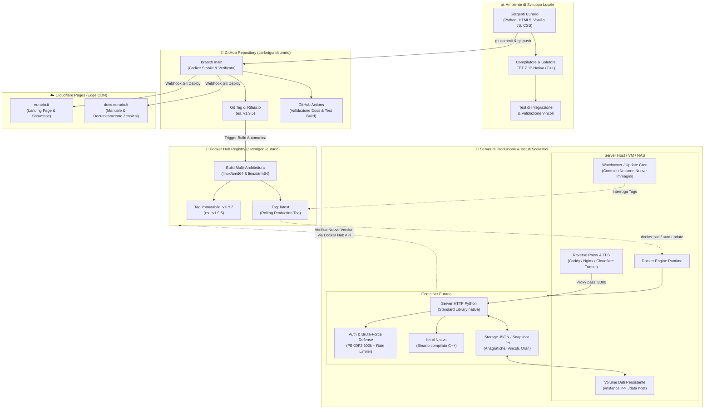
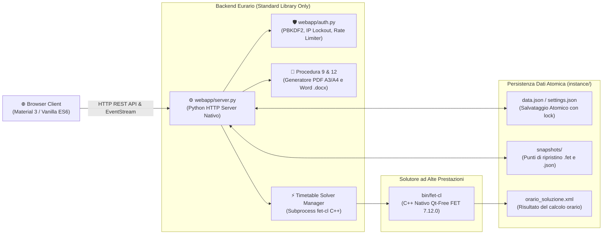
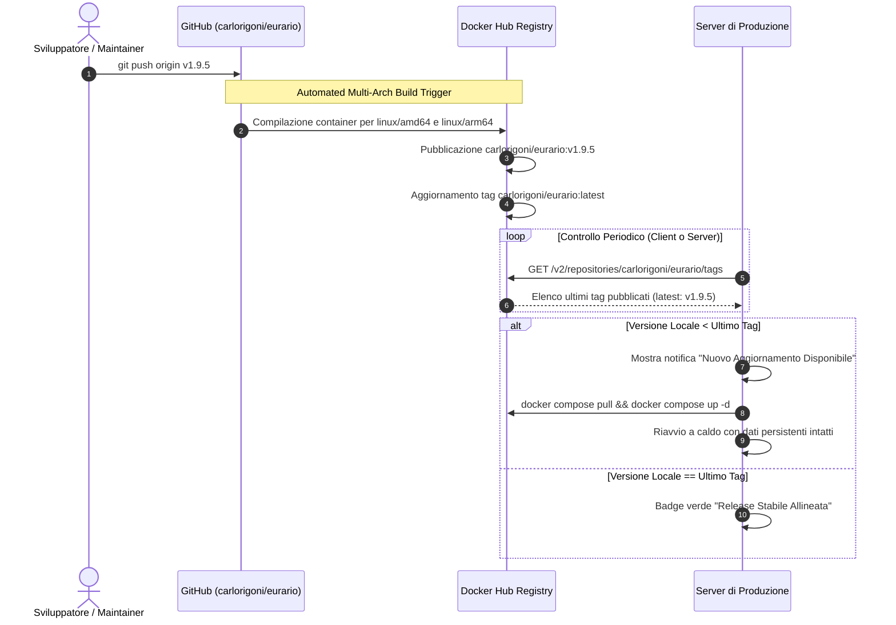

# 🏗️ Architettura del Software & Pipeline DevOps

Eurario è progettato secondo una filosofia ingegneristica rigorosa: **zero dipendenze esterne Python**, footprint di memoria minimale, motore solutore nativo in C++ ad alte prestazioni e una pipeline automatizzata di Continuous Integration e Continuous Deployment (CI/CD) che garantisce massima affidabilità sia per installazioni cloud gestite che per server on-premise scolastici.

In questa pagina viene descritto in dettaglio il funzionamento dell'intero ecosistema: dall'editing dei file sorgente in ambiente di sviluppo locale, ai workflow di controllo versione su GitHub, alla generazione delle immagini container su Docker Hub, fino alla distribuzione automatica su Cloudflare Pages e all'aggiornamento dei server di produzione.

---

## 1. Mappa E2E dell'Ecosistema Eurario

Il diagramma seguente illustra l'intero flusso di interazione tra i componenti locali, i repository remoti, i registri container, la rete CDN e i server di produzione:



---

## 2. Componenti Software Interni & Runtime Locale

L'architettura del software è concepita per eliminare qualsiasi complessità superflua e garantire longevità decennale senza rotture provocate da aggiornamenti di librerie di terze parti:



### Dettaglio dei singoli layer:

1. **Frontend (Zero-Framework Vanilla Stack)**:
   - Scritto in **HTML5 semantico**, **Vanilla ES6+ JavaScript** e **CSS moderno** con variabili personalizzate per il supporto dinamico a Tema Chiaro e Tema Scuro.
   - Design System ispirato a Google Classroom / Google Material 3 (colori istituzionali `#1B2A4A`, `#059669`, `#E4572E`, card modulari, rail flyout per la barra laterale).
   - Nessun bundler (Webpack, Vite o Rollup) in fase di esecuzione: il caricamento è immediato, con cache-busting automatico tramite query param di versione (`?v=1.9.5`).

2. **Backend Python (`webapp/server.py` & `webapp/auth.py`)**:
   - Esegue su Python 3.10+ utilizzando **esclusivamente moduli della Standard Library**: `http.server`, `urllib`, `json`, `hashlib`, `hmac`, `secrets`, `subprocess`, `threading`.
   - Nessun framework pesante (Django/FastAPI) e nessuna dipendenza di rete runtime.
   - Sicurezza enterprise: password con hash crittografico **PBKDF2-HMAC-SHA256 a 600.000 iterazioni**, salting casuale crittografico (16 byte), delay esponenziale (tarpit) e blocco IP automatico temporizzato contro attacchi brute-force.

3. **Motore Solutore Euristico (`bin/fet-cl`)**:
   - Binario compilato nativo in C++ dal codice sorgente di FET 7.12.0 (ideato da Liviu Lalescu e Volker Dirr).
   - Viene invocato dal server Python come subprocess indipendente con passaggio argomenti ottimizzato. Non carica l'interfaccia grafica Qt, operando in modalità pura a riga di comando per la massima velocità di calcolo e stabilità su server headless.

4. **Storage Atomico su File System (`instance/` e `data/`)**:
   - Nessun database relazionale esterno da configurare o mantenere (niente Postgres o MySQL complessi).
   - I dati scolastici, le anagrafiche docenti, i blocchi orari e le preferenze risiedono in file JSON strutturati.
   - Le scritture su disco sono atomiche (scrittura su file temporaneo seguita da `os.replace`), prevenendo qualsiasi corruzione anche in caso di improvvisa interruzione di alimentazione.

---

## 3. Gestione del Controllo di Versione & Flusso Git

Eurario adotta il modello **Semantic Versioning (SemVer 2.0.0)** nel formato `vMAJOR.MINOR.PATCH`:

* **`MAJOR`**: Rilasci architetturali di vasta portata o cambiamenti strutturali profondi.
* **`MINOR`**: Nuove funzionalità applicative, integrazioni di nuove procedure di stampa o estensioni dei vincoli FET.
* **`PATCH`**: Correzioni di bug, ottimizzazioni prestazionali, rifiniture grafiche e aggiornamenti di sicurezza.

### File sincronizzati all'avanzamento di versione:

A ogni cambio versione, un set coerente di file viene sincronizzato per garantire che l'intero ecosistema esponga lo stesso identico identificativo:

| File | Identificativo / Variabile | Scopo |
| :--- | :--- | :--- |
| `webapp/server.py` | `APP_VERSION = "1.9.5"` | Esposta dalle API server e nei log di avvio |
| `webapp/static/app.js` | `const APP_VERSION = '1.9.5'` | Utilizzata per il check remoto su Docker Hub |
| `webapp/static/index.html` | Etichette UI e cache buster (`?v=1.9.5`) | Sidebar, About modal e invalidazione cache browser |
| `landing/content/site_data.json` | `"current_version": "v1.9.5"` | Visualizzazione versione su eurario.it e annunci |
| `landing/index.html` | `#liveVerTag` | Tag dell'immagine consigliata nella sezione hero |
| `zensical.toml` | Query parameter asset CSS/JS | Cache busting per la documentazione docs.eurario.it |

---

## 4. Pipeline di Containerizzazione su Docker Hub

Alla creazione di un nuovo Git Tag (es. `git tag v1.9.5 && git push origin v1.9.5`), viene generata l'immagine container multi-piattaforma ufficiale:



### Multi-Architettura:
La build genera un unico manifest multi-arch che raggruppa:
- **`linux/amd64`**: per server cloud tradizionali, VM e PC con processori Intel/AMD.
- **`linux/arm64`**: per Apple Silicon (M1/M2/M3/M4), VPS Hetzner CAX basati su Ampere Altra e Raspberry Pi 5.

Quando l'amministratore esegue `docker pull carlorigoni/eurario:latest`, il demone Docker seleziona in automatico l'architettura adatta all'hardware in uso.

---

## 5. Controllo di Versione & Aggiornamenti nel Server di Produzione

Eurario include un meccanismo integrato di autodiagnosi e monitoraggio degli aggiornamenti accessibile sia dalla barra di stato della WebApp che tramite automazione di sistema:

### 1. Rilevamento tramite API di Docker Hub
Nella WebApp, la funzione client interroga l'endpoint pubblico:
```http
GET https://hub.docker.com/v2/repositories/carlorigoni/eurario/tags?page_size=10
```
La risposta JSON contiene tutti i tag rilasciati con i relativi digest e timestamp di creazione. L'algoritmo di confronto estrae l'ultimo tag valido che segue la convenzione `vX.Y.Z` e lo confronta numericamente con `APP_VERSION`:

* Se `Versione Remota > Versione Locale`: il badge nel footer della sidebar diventa arancione/ambra e invita l'amministratore a procedere con l'aggiornamento.
* Cliccando sul badge, si apre il **Modal di Verifica Aggiornamenti** con la data del rilascio e le istruzioni immediate di aggiornamento.

### 2. Aggiornamento Manuale (Zero Rischio)
Per aggiornare un'installazione Docker Compose esistente, è sufficiente eseguire due comandi nella directory del server:

```bash
docker compose pull
docker compose up -d
```

Grazie al montaggio del volume locale (`./data:/app/data` o `./instance:/app/instance`), il container precedente viene sostituito dal nuovo in meno di 5 secondi, mantenendo intatti al 100%:
- Anagrafiche dell'istituto e docenti;
- Storico degli snapshot e file `.fet`;
- Password e credenziali master;
- Registri di audit e log degli accessi.

### 3. Aggiornamento Automatico Notturno con Watchtower
Per gli istituti scolastici che desiderano aggiornamenti silenti e automatici senza interventi manuali, è possibile affiancare il container **Watchtower**:

```yaml
version: '3.8'

services:
  eurario:
    image: carlorigoni/eurario:latest
    container_name: eurario-app
    restart: unless-stopped
    ports:
      - "8000:8000"
    volumes:
      - ./data:/app/data
    environment:
      - PORT=8000

  watchtower:
    image: containrrr/watchtower
    container_name: eurario-watchtower
    restart: unless-stopped
    volumes:
      - /var/run/docker.sock:/var/run/docker.sock
    command: --interval 86400 --cleanup eurario-app
```

> [!NOTE]
> Con questa configurazione, ogni 24 ore Watchtower verifica se su Docker Hub è presente un'immagine più recente di `carlorigoni/eurario:latest`. Se presente, la scarica, riavvia `eurario-app` e rimuove la vecchia immagine inutilizzata.

---

## 6. Cloudflare Pages & Distribuzione Globale dei Siti

La landing page istituzionale ([eurario.it](https://eurario.it)) e il portale di documentazione ([docs.eurario.it](https://docs.eurario.it)) sono serviti direttamente dalla rete edge globale di Cloudflare:

1. **Deploy Continuo su Push**: A ogni push sul branch `main` di GitHub, i webhook di Cloudflare Pages clonano il repository.
2. **Generazione Statica**:
   - Per `docs.eurario.it`, viene eseguito Zensical:
     ```bash
     zensical build
     ```
   - Per `eurario.it`, i file statici (`landing/`) vengono ottimizzati e distribuiti istantaneamente.
3. **Distribuzione su 300+ Città nel Mondo**: La documentazione e la landing page beneficiano di tempi di risposta sub-millisecondo, certificato SSL/TLS automatico e protezione DDoS senza gravare sul server di produzione dell'applicazione.
