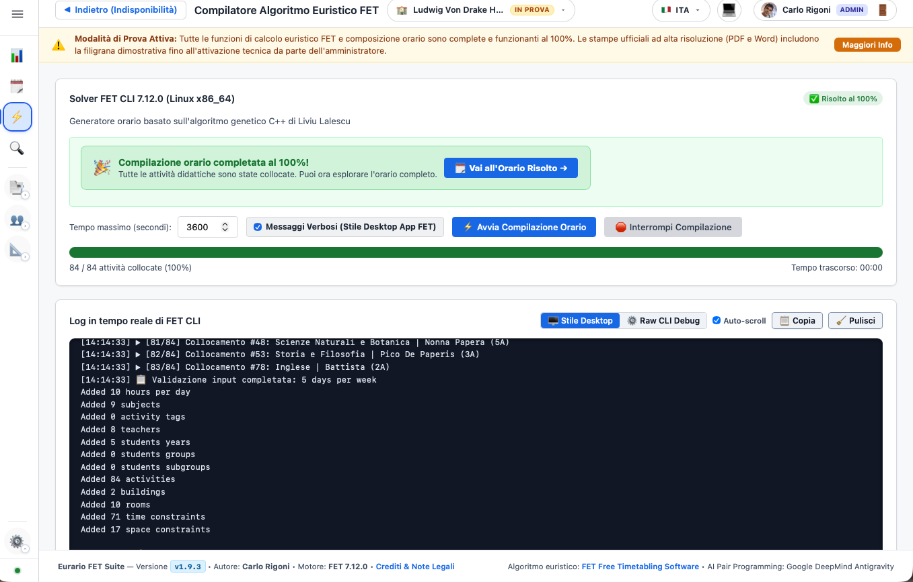

# 🔬 Cross-Reference: Parametri Eurario & Vincoli XML FET

Il motore solutore di Eurario è alimentato dal binario ufficiale ad alte prestazioni **FET** (*Free Timetabling Software*).

Questa pagina documenta la corrispondenza biunivoca e analitica tra ogni singolo parametro configurabile nell'interfaccia didattica di Eurario e la relativa struttura XML compilata per il motore FET ([Manuale Ufficiale FET](https://www.timetabling.de/manual/FET-manual.en.html)).

---

## 1. Mappatura Entità Fondamentali

| Concetto in Eurario | Entità XML FET | Attributi e Note Architetturali |
| :--- | :--- | :--- |
| **Docente** | `<Teacher>` | Identificato univocamente da `<Name>`. Contiene la classe di concorso (CDC) e il monte ore nei commenti. |
| **Classe Ordinaria** | `<Year>` | Rappresenta la coorte degli studenti (es. `1A`, `3B`, `5CSA`). In FET definisce il raggruppamento di studenti di massimo livello. |
| **Indirizzo / Articolazione** | `<Group>` | Sottogruppo di una classe che condivide lezioni comuni ma si separa per indirizzi specifici (es. `3A_INFO`, `3A_TEL`). |
| **Gruppo Linguistico / Laboratorio** | `<Subgroup>` | Unità atomica di studenti usata per divisioni a metà classe (es. `1A_FRA`, `1A_SPA`). |
| **Materia Scolastica** | `<Subject>` | Disciplina d'insegnamento curricolare. Se configurata con sigla `short_name`, la sigla viene usata per le stampe mentre in FET viene preservato il nome identificativo. |
| **Cattedra Didattica** | Gruppo `<Activity>` | Ciascuna cattedra viene atomizzata in sotto-attività convesse collegate dal medesimo `<Activity_Group_Id>`. |
| **Plesso Scolastico** | `<Building>` | Edificio fisico dell'istituto (es. *Centrale*, *Succursale*). |
| **Aula / Laboratorio** | `<Room>` | Spazio fisico assegnato a un `<Building>` con capienza massima `<Capacity>`. |

---

## 2. Vincoli Temporali Docenti (`Time_Constraints_List`)

### A. Giorno Libero Contrattuale & Indisponibilità Orarie
* **Interfaccia Eurario**: Scheda *Disponibilità Docente* &rarr; Matrice settimanale cliccabile (giorni x ore).
* **Tag XML FET**: `<ConstraintTeacherNotAvailableTimes>`
* **Codice XML Generato**:
  ```xml
  <ConstraintTeacherNotAvailableTimes>
    <Weight_Percentage>100</Weight_Percentage>
    <Teacher_Name>Rossi Mario</Teacher_Name>
    <Number_of_Not_Available_Times>6</Number_of_Not_Available_Times>
    <Not_Available_Time>
      <Day>Sab</Day>
      <Hour>1</Hour>
    </Not_Available_Time>
    <!-- ... ore da 1 a 6 per il sabato libero -->
  </ConstraintTeacherNotAvailableTimes>
  ```
* **Impatto Risolutivo**: Vincolo rigido (*Hard Constraint 100%*). FET esclude tassativamente la collocazione di attività didattiche in quegli slot.

### B. Giorni Massimi e Minimi di Servizio a Settimana
* **Interfaccia Eurario**: Modale Docente &rarr; *Giorni di presenza settimanali* (`min_days` e `max_days`).
* **Tag XML FET**:
  * `<ConstraintTeacherMaxDaysPerWeek>`
  * `<ConstraintTeacherMinDaysPerWeek>`
* **Codice XML Generato**:
  ```xml
  <ConstraintTeacherMaxDaysPerWeek>
    <Weight_Percentage>100</Weight_Percentage>
    <Teacher_Name>Bianchi Laura</Teacher_Name>
    <Max_Days_Per_Week>4</Max_Days_Per_Week>
  </ConstraintTeacherMaxDaysPerWeek>
  <ConstraintTeacherMinDaysPerWeek>
    <Weight_Percentage>100</Weight_Percentage>
    <Teacher_Name>Bianchi Laura</Teacher_Name>
    <Min_Days_Per_Week>3</Min_Days_Per_Week>
  </ConstraintTeacherMinDaysPerWeek>
  ```
* **Utilizzo Pratico**: Indispensabile per part-time verticali (es. docente presente solo su 3 o 4 giorni specifici) ed eliminazione di giorni frammentati.

### C. Finestre Libere (Ore Buche Giornaliere e Settimanali)
* **Interfaccia Eurario**: Impostazioni Istituto &rarr; *Max buchi al giorno* (default 1) e *Max buchi alla settimana* (default 2-3).
* **Tag XML FET**:
  * `<ConstraintTeacherMaxGapsPerDay>` (Peso 95-100%)
  * `<ConstraintTeacherMaxGapsPerWeek>` (Peso 95-100%)
* **Codice XML Generato**:
  ```xml
  <ConstraintTeacherMaxGapsPerDay>
    <Weight_Percentage>98</Weight_Percentage>
    <Teacher_Name>Verdi Giuseppe</Teacher_Name>
    <Max_Gaps>1</Max_Gaps>
  </ConstraintTeacherMaxGapsPerDay>
  <ConstraintTeacherMaxGapsPerWeek>
    <Weight_Percentage>95</Weight_Percentage>
    <Teacher_Name>Verdi Giuseppe</Teacher_Name>
    <Max_Gaps>2</Max_Gaps>
  </ConstraintTeacherMaxGapsPerWeek>
  ```

### D. Massimo e Minimo Ore Giornaliere di Lezione
* **Interfaccia Eurario**: Impostazioni Orario &rarr; *Ore massime di lezione al giorno* e *Minimo ore nei giorni di presenza*.
* **Tag XML FET**:
  * `<ConstraintTeacherMaxHoursDaily>`: Limita il carico didattico a 4 o 5 ore al giorno.
  * `<ConstraintTeacherMinHoursDaily>`: Impone un minimo di 2 ore nei giorni lavorativi per evitare uscite antieconomiche per 1 sola ora di lezione.
  * `<ConstraintTeacherMaxSpanPerDay>`: Limita la permanenza complessiva del docente a scuola (dalla prima all'ultima ora).

---

## 3. Vincoli Temporali Studenti & Classi

### A. Compattezza Orario Studenti (Zero Ore Buche)
* **Interfaccia Eurario**: Attivo di default per tutte le classi.
* **Tag XML FET**:
  * `<ConstraintStudentsMaxGapsPerDay>`: `<Max_Gaps>0</Max_Gaps>` (Peso 100%)
  * `<ConstraintStudentsMaxGapsPerWeek>`: `<Max_Gaps>0</Max_Gaps>` (Peso 100%)
* **Effetto Risolutivo**: Garantisce che nessuna classe abbia ore buche non presidiate tra una lezione e l'altra.

### B. Ingressi Posticipati alla Seconda Ora
* **Interfaccia Eurario**: Impostazioni Istituto &rarr; *Massimo ingressi alla seconda ora a settimana*.
* **Tag XML FET**: `<ConstraintStudentsEarlyMaxBeginningsAtSecondHour>`
* **Codice XML Generato**:
  ```xml
  <ConstraintStudentsEarlyMaxBeginningsAtSecondHour>
    <Weight_Percentage>100</Weight_Percentage>
    <Max_Beginnings_At_Second_Hour>0</Max_Beginnings_At_Second_Hour>
  </ConstraintStudentsEarlyMaxBeginningsAtSecondHour>
  ```
* **Effetto Risolutivo**: Se impostato a 0, impone che per tutte le classi le lezioni inizino sempre rigorosamente alla prima ora della mattina.

### C. Pause Didattiche e Intervallo di Istituto
* **Interfaccia Eurario**: Impostazioni Orario &rarr; *Intervallo Ricreazione*.
* **Tag XML FET**: `<ConstraintBreakTimes>`
* **Effetto Risolutivo**: Blocca la collocazione di lezioni durante le pause deliberate dal collegio docenti.

---

## 4. Vincoli sulle Discipline & Suddivisione Cattedre

### A. Distanziamento tra le Lezioni della Stessa Materia
* **Interfaccia Eurario**: Calcolato automaticamente per ciascuna cattedra suddivisa in blocchi (es. `2+1+1`).
* **Tag XML FET**: `<ConstraintMinDaysBetweenActivities>`
* **Codice XML Generato**:
  ```xml
  <ConstraintMinDaysBetweenActivities>
    <Weight_Percentage>98</Weight_Percentage>
    <Consecutive_If_Same_Day>true</Consecutive_If_Same_Day>
    <Number_of_Activities>3</Number_of_Activities>
    <Activity_Id>101</Activity_Id>
    <Activity_Id>102</Activity_Id>
    <Activity_Id>103</Activity_Id>
    <MinDays>1</MinDays>
  </ConstraintMinDaysBetweenActivities>
  ```
* **Effetto Risolutivo**: Impone che le singole lezioni si tengano in giorni diversi della settimana e che, qualora eccezionalmente assegnate nello stesso giorno, debbano essere obbligatoriamente consecutive (`Consecutive_If_Same_Day=true`).

### B. Fascia Oraria Preferita (Prime Ore / Ultime Ore)
* **Interfaccia Eurario**: Modale Materia &rarr; *Fascia Oraria Preferita* (`PRIME`, `ULTIME`, `INDIFFERENTE`).
* **Tag XML FET**: `<ConstraintActivitiesPreferredTimeSlots>`
* **Configurazione**:
  * `PRIME`: Assegna un peso di preferenza per le ore 1, 2 e 3 (ottimale per Matematica, Latino o compiti scritti).
  * `ULTIME`: Assegna un peso di preferenza per le ore 4, 5 e pomeridiane (ottimale per Scienze Motorie o Laboratori Artistici).

### C. Esclusione Rientri Pomeridiani (`no_rientri`)
* **Interfaccia Eurario**: Modale Materia &rarr; *Escludi dai Rientri Pomeridiani*.
* **Tag XML FET**: `<ConstraintActivitiesPreferredTimeSlots>` impostato con divieto assoluto sugli slot pomeridiani (7ª e 8ª ora).

### D. Attività Bloccate Manualmente dalla Commissione
* **Interfaccia Eurario**: Icona Lucchetto sulla griglia orario.
* **Tag XML FET**: `<ConstraintActivityPreferredStartingTime>` (Hard 100%). Fissa in modo inamovibile giorno e ora di inizio dell'attività.

---

## 5. Vincoli Spaziali & Gestione Multi-Plesso (`Space_Constraints_List`)

### A. Aula Base della Classe (Home Room)
* **Interfaccia Eurario**: Modale Classe &rarr; *Aula Base*.
* **Tag XML FET**: `<ConstraintStudentsSetHomeRoom>`
* **Codice XML Generato**:
  ```xml
  <ConstraintStudentsSetHomeRoom>
    <Weight_Percentage>100</Weight_Percentage>
    <Students>3A</Students>
    <Room>Aula 204</Room>
  </ConstraintStudentsSetHomeRoom>
  ```

### B. Laboratori & Palestre Condivise
* **Interfaccia Eurario**: Assegnazione Cattedra &rarr; *Laboratorio / Palestra*.
* **Tag XML FET**: `<ConstraintActivityPreferredRooms>`
* **Codice XML Generato**:
  ```xml
  <ConstraintActivityPreferredRooms>
    <Weight_Percentage>100</Weight_Percentage>
    <Activity_Id>205</Activity_Id>
    <Number_of_Preferred_Rooms>1</Number_of_Preferred_Rooms>
    <Preferred_Room>Lab_Informatica_1</Preferred_Room>
  </ConstraintActivityPreferredRooms>
  ```

### C. Spostamento Docenti tra Sedi (Centrale & Succursale)
* **Interfaccia Eurario**: Impostazioni Plessi & Sedi d'Istituto.
* **Tag XML FET**:
  1. `<ConstraintTeachersMaxBuildingChangesPerDay>`: Limita i cambi plesso nello stesso giorno a un massimo prefissato (tipicamente max 1).
  2. `<ConstraintTeachersMaxBuildingChangesPerWeek>`: Limita i cambi plesso nell'arco dell'intera settimana (tipicamente max 2 o 3).
  3. `<ConstraintTeachersMinGapsBetweenBuildingChanges>`: Impone un intervallo orario vuoto minimo (es. 1 ora di buco obbligatoria per il tempo di percorrenza stradale) prima che il docente possa iniziare la lezione nel nuovo plesso.

---

## 6. Visualizzazione Risultati: FET Nativo vs Eurario

<div class="doc-figure">
  
  <div class="doc-caption">Figura 4.1: Interfaccia desktop ufficiale di FET, con i menu per la gestione di vincoli temporali, vincoli spaziali e risoluzione orario.</div>
</div>

| Funzionalità | Interfaccia Web Nativa FET | Esperienza Eurario |
| :--- | :--- | :--- |
| **Rappresentazione Cattedre** | Frammentata in sotto-attività isolate | Visualizzazione unificata per docente e classe con blocchi compatti |
| **Multi-Plesso** | Segnalazioni testuali generiche | Badge colorati Centrale/Succursale e avviso automatico cambi sede |
| **Disposizioni & Supplenze** | Non supportate (richiedono ore fittizie) | Algoritmo proprietario dedicato di riempimento buchi e bilanciamento |
| **Modifiche Post-Calcolo** | Ricalcolo completo necessario | Griglia interattiva Drag & Drop con verifica collisioni in tempo reale |
| **Esportazione Finale** | Tabelle HTML grezze | Word (.docx) A3 Orizzontale (Procedura 12) e PDF tipografici |
