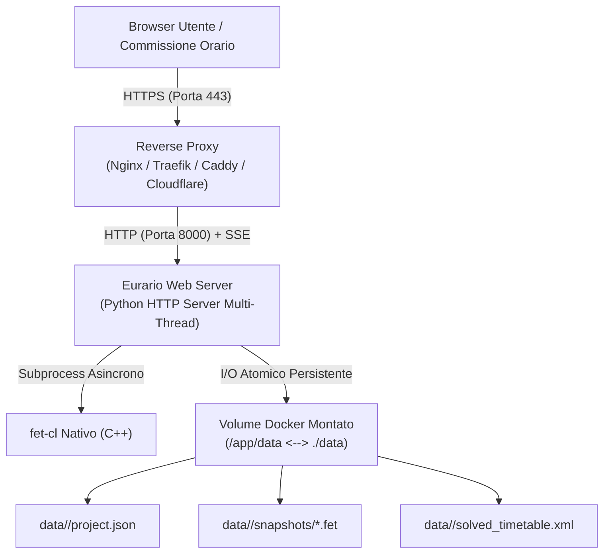

# 🐳 Installazione & Deploy con Docker

Eurario è distribuito come immagine container multi-architettura (**Linux `amd64`** per server Intel/AMD e **Linux `arm64`** per Apple Silicon, Raspberry Pi 5 e server ARM) sul registro ufficiale Docker Hub:

> 📦 **Immagine Ufficiale**: [`carlorigoni/eurario:latest`](https://hub.docker.com/r/carlorigoni/eurario)

---

## 1. Requisiti di Sistema & Architettura

* **Sistemi Operativi Supportati**: Ubuntu Server 22.04/24.04 LTS, Debian 12, Rocky Linux / AlmaLinux 9, Synology DSM 7+ (Container Manager), QNAP QuTS, macOS e Windows con Docker Desktop.
* **Architetture Hardware**:
  * `x86_64 / amd64` (Server dedicati, VM VMware ESXi, Proxmox VE, VPS Hetzner/OVH/AWS).
  * `aarch64 / arm64` (Server Hetzner ARM CAX, Apple Silicon M-Series, Raspberry Pi 5 con 4GB+ RAM).
* **Software**: Docker Engine 24+ e Docker Compose v2+.
* **Risorse Consigliate**: Minimo 1 vCPU e 1 GB di RAM (2 GB consigliati per istituti con oltre 100 docenti e solutore intensivo).



---

## 2. Deploy Rapido con Docker Compose

Creare una directory di progetto sul server:

```bash
mkdir -p /opt/eurario && cd /opt/eurario
```

Creare il file `docker-compose.yml`:

```yaml
version: '3.8'

services:
  eurario:
    image: carlorigoni/eurario:latest
    container_name: eurario-app
    restart: unless-stopped
    ports:
      - "8000:8000"
    volumes:
      - ./data:/app/data
    environment:
      - PORT=8000
      - PYTHONUNBUFFERED=1
      # Opzionale: Autenticazione Google Workspace OAuth 2.0
      # - GOOGLE_CLIENT_ID=vostro-client-id.apps.googleusercontent.com
      # Opzionale: Email superadmin approvato automaticamente al primo avvio
      # - INITIAL_ADMIN_EMAIL=dirigente@istituto.edu.it
    healthcheck:
      test: ["CMD-SHELL", "python3 -c \"import urllib.request; urllib.request.urlopen('http://localhost:8000/api/summary')\""]
      interval: 30s
      timeout: 10s
      retries: 3
      start_period: 10s
```

Avviare il servizio in modalità demone:

```bash
docker compose up -d
```

Verificare i log e lo stato di salute:

```bash
docker compose ps
docker compose logs -f
```

L'applicazione risponderà immediatamente all'indirizzo: `http://ip-server:8000/`.

---

## 3. Variabili di Ambiente Supportate

| Variabile | Valore Predefinito | Descrizione |
| :--- | :---: | :--- |
| `PORT` | `8000` | Porta TCP d'ascolto del web server interno. |
| `PYTHONUNBUFFERED` | `1` | Forza l'output immediato dei log senza buffering interno. |
| `GOOGLE_CLIENT_ID` | *(non impostato)* | ID Client OAuth 2.0 di Google Workspace. Se omesso, abilita la modalità locale standalone. |
| `INITIAL_ADMIN_EMAIL` | *(non impostato)* | Indirizzo email d'istituto a cui assegnare automaticamente il ruolo di Superadmin al primo accesso. |

---

## 4. Persistenza dei Dati & Backup Strategico

Tutte le anagrafiche, le cattedre, gli snapshot e i risultati dell'orario risiedono all'interno del volume montato `./data`.

### Struttura delle Directory:
```text
/opt/eurario/data/
├── default/                         # Scuola predefinita
│   ├── project.json                 # Database principale (docenti, cattedre, vincoli)
│   ├── solved_timetable.xml         # Risultato dell'ultimo calcolo FET
│   └── snapshots/                   # Istantanee storiche salvate
│       ├── 20261027_baseline.fet
│       └── 20261027_definitivo.fet
└── liceo_artistico/                 # Altri istituti (Multi-Tenant)
    └── project.json
```

### Script Automatico di Backup Giornaliero
Poiché i dati sono memorizzati in formato JSON e XML standard, il backup a caldo non richiede blocchi di tabelle SQL:

```bash
# Aggiungere a crontab (crontab -e) per eseguire ogni notte alle 02:00
0 2 * * * tar -czvf /backup/eurario-$(date +\%F).tar.gz -C /opt/eurario data/
```

Per ripristinare un backup:
```bash
docker compose stop
tar -xzvf /backup/eurario-2026-10-27.tar.gz -C /opt/eurario/
docker compose start
```

---

## 5. Reverse Proxy & Certificato SSL / HTTPS

Per abilitare l'accesso sicuro HTTPS e il corretto funzionamento di Google OAuth, si consiglia di esporre Eurario dietro un reverse proxy con supporto completo per **Server-Sent Events (SSE)**.

### A. Configurazione Nginx (Consigliata)
Un aspetto critico per il solutore FET è disattivare il buffer del proxy per l'endpoint di streaming `/api/solver/stream`:

```nginx
server {
    listen 80;
    server_name orario.scuola.edu.it;
    return 301 https://$host$request_uri;
}

server {
    listen 443 ssl http2;
    server_name orario.scuola.edu.it;

    ssl_certificate /etc/letsencrypt/live/orario.scuola.edu.it/fullchain.pem;
    ssl_certificate_key /etc/letsencrypt/live/orario.scuola.edu.it/privkey.pem;
    ssl_protocols TLSv1.2 TLSv1.3;

    location / {
        proxy_pass http://127.0.0.1:8000;
        proxy_set_header Host $host;
        proxy_set_header X-Real-IP $remote_addr;
        proxy_set_header X-Forwarded-For $proxy_add_x_forwarded_for;
        proxy_set_header X-Forwarded-Proto $scheme;

        # Supporto essenziale per streaming Server-Sent Events (SSE)
        proxy_http_version 1.1;
        proxy_set_header Connection '';
        proxy_buffering off;
        proxy_cache off;
        chunked_transfer_encoding off;
        proxy_read_timeout 600s;
    }
}
```

### B. Configurazione con Caddy
Se si preferisce Caddy con certificati Let's Encrypt automatici:

```caddyfile
orario.scuola.edu.it {
    reverse_proxy localhost:8000 {
        header_up Host {host}
        header_up X-Real-IP {remote_host}
    }
}
```

### C. Esposizione Sicura con Cloudflare Tunnel (Zero Porte Aperte)
Per istituti scolastici dotati di connessione con IP dinamico o firewall ministeriale protetto senza possibilità di aprire la porta 80/443:

```bash
# 1. Installare il demone cloudflared
curl -L --output cloudflared.deb https://github.com/cloudflare/cloudflared/releases/latest/download/cloudflared-linux-amd64.deb
sudo dpkg -i cloudflared.deb

# 2. Autenticare ed associare il sottodominio d'istituto
cloudflared tunnel login
cloudflared tunnel create eurario-scuola
cloudflared tunnel route dns eurario-scuola orario.scuola.edu.it

# 3. Avviare il tunnel come servizio di sistema
cloudflared tunnel run --url http://localhost:8000 eurario-scuola
```
Con questa configurazione, l'orario sarà accessibile globalmente in HTTPS senza esporre direttamente l'infrastruttura di rete della scuola.
