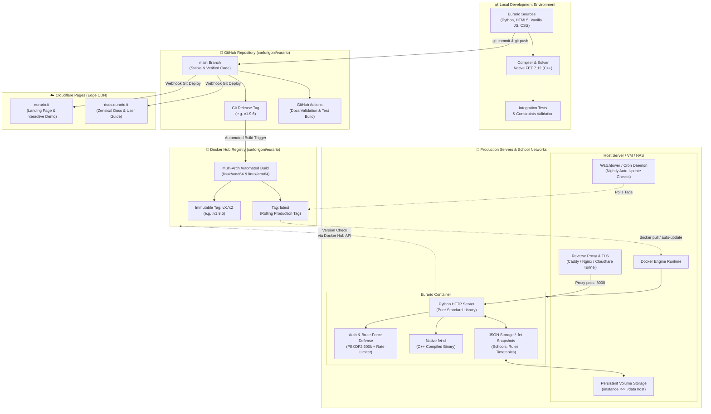
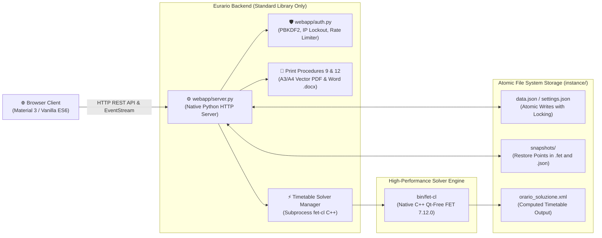
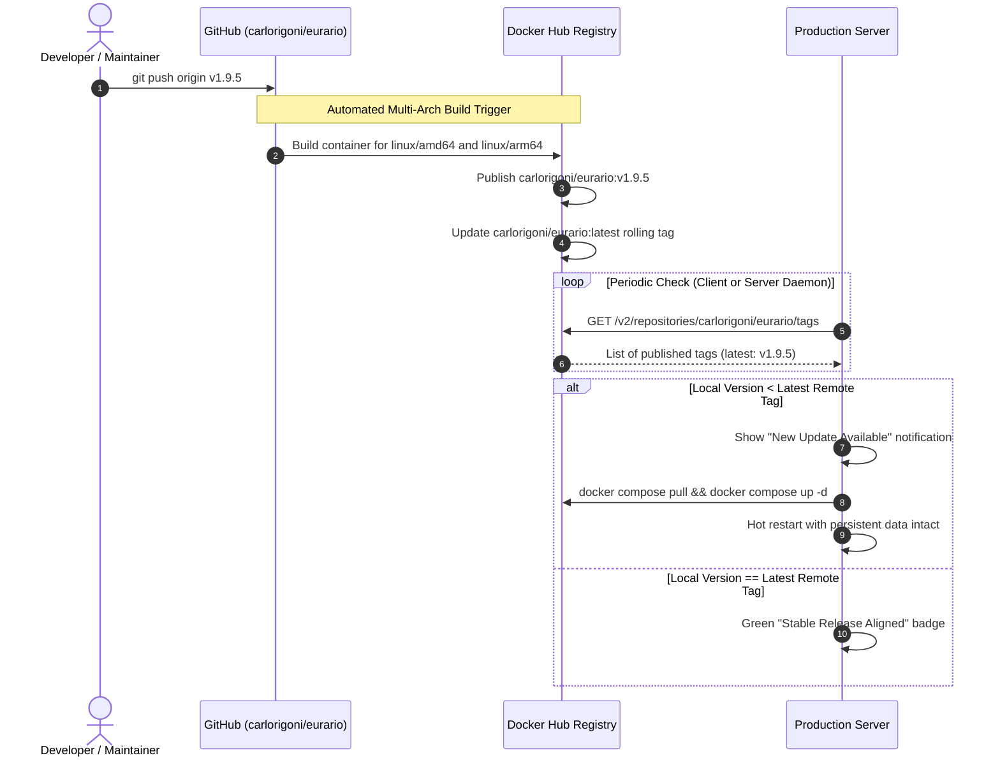
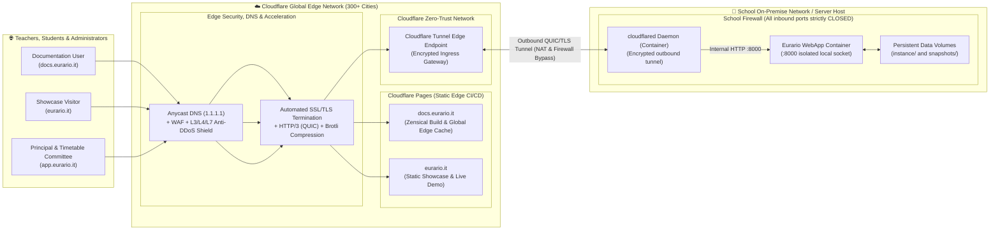

# 🏗️ Software Architecture & DevOps Pipeline

Eurario is engineered according to a strict design philosophy: **zero external Python dependencies**, minimal memory footprint, a high-performance native C++ timetabling solver, and an automated Continuous Integration and Continuous Deployment (CI/CD) pipeline ensuring enterprise-grade stability for both turnkey cloud environments and on-premise school servers.

This document details the end-to-end operational architecture: from local source code editing, to Git release tracking on GitHub, multi-architecture image building on Docker Hub, edge deployment via Cloudflare Pages, and zero-downtime updates on production servers.

---

## 1. End-to-End Ecosystem Architecture

The following diagram illustrates the interactions between local components, remote repositories, container registries, edge CDN networks, and production environments:



---

## 2. Internal Runtime Architecture & Component Stack

The internal runtime architecture is designed to eliminate fragile dependencies and deliver rock-solid performance over decades without breaking due to upstream library updates:



### Layer Details:

1. **Frontend (Zero-Framework Vanilla Stack)**:
   - Built with **semantic HTML5**, **Vanilla ES6+ JavaScript**, and **modern CSS** with custom properties for responsive Light/Dark theme switching.
   - Design System inspired by Google Classroom / Material 3 (accent colors `#1B2A4A`, `#059669`, `#E4572E`, modular cards, collapsible rail flyout navigation).
   - No runtime bundlers (Webpack/Vite/Rollup) required: instantaneous loading with asset cache-busting via version query parameters (`?v=1.9.5`).

2. **Python Backend (`webapp/server.py` & `webapp/auth.py`)**:
   - Runs on Python 3.10+ using **exclusively Standard Library modules**: `http.server`, `urllib`, `json`, `hashlib`, `hmac`, `secrets`, `subprocess`, `threading`.
   - No heavy web frameworks (Django/FastAPI) and zero runtime network dependencies.
   - Enterprise security: password hashing via **PBKDF2-HMAC-SHA256 with 600,000 iterations**, cryptographic salt (16 bytes), progressive exponential tarpit delays, and automated IP lockout against brute-force attacks.

3. **Heuristic Solver Engine (`bin/fet-cl`)**:
   - Native C++ compiled binary from FET 7.12.0 sources (created by Liviu Lalescu and Volker Dirr).
   - Invoked by the Python server as an isolated subprocess with optimized argument passing. It operates headlessly without the Qt GUI, providing maximum calculation speed and stability on server hardware.

4. **Atomic Disk Storage (`instance/` & `data/`)**:
   - No external SQL database servers to configure, maintain, or troubleshoot.
   - School metadata, faculty rosters, period blocks, and constraints reside in structured JSON files.
   - All disk writes are atomic (write to temporary file followed by atomic `os.replace`), preventing data corruption even during abrupt power cuts.

---

## 3. Version Control & Release Management

Eurario strictly follows **Semantic Versioning (SemVer 2.0.0)** formatted as `vMAJOR.MINOR.PATCH`:

* **`MAJOR`**: Substantial architectural overhauls or schema breaking shifts.
* **`MINOR`**: Significant features, new official print export procedures, or FET constraint extensions.
* **`PATCH`**: Bug fixes, performance optimizations, UI refinements, and security hardening.

### Synchronized Release Identifiers:

Whenever a new version is released, the following files are synchronized to ensure identical version reporting across all touchpoints:

| File | Variable / Marker | Role |
| :--- | :--- | :--- |
| `webapp/server.py` | `APP_VERSION = "1.9.5"` | Reported in server APIs and system startup logs |
| `webapp/static/app.js` | `const APP_VERSION = '1.9.5'` | Used by the client for remote Docker Hub verification |
| `webapp/static/index.html` | UI badges and cache buster (`?v=1.9.5`) | Sidebar, About modal, and browser cache busting |
| `landing/content/site_data.json` | `"current_version": "v1.9.5"` | Hero tag and release announcement on eurario.it |
| `landing/index.html` | `#liveVerTag` | Recommended Docker image tag in the hero banner |
| `zensical.toml` | CSS/JS asset query parameter | Documentation asset cache busting on docs.eurario.it |

---

## 4. Container Registry Pipeline on Docker Hub

When a new Git Release Tag is pushed (e.g. `git tag v1.9.5 && git push origin v1.9.5`), an official multi-architecture container build is triggered:



### Multi-Architecture Support:
The automated build produces a unified multi-arch manifest:
- **`linux/amd64`**: For traditional cloud servers, VMs, and Intel/AMD hardware.
- **`linux/arm64`**: For Apple Silicon (M1/M2/M3/M4), Hetzner Ampere Altra CAX VPS, and Raspberry Pi 5.

When an administrator executes `docker pull carlorigoni/eurario:latest`, the Docker engine automatically pulls the matching architecture.

---

## 5. Production Version Checking & Update Strategies

Eurario includes built-in diagnostic and update tracking accessible directly from the WebApp footer and automated daemon tools:

### 1. Docker Hub API Inspection
In the WebApp, the client queries the official public registry endpoint:
```http
GET https://hub.docker.com/v2/repositories/carlorigoni/eurario/tags?page_size=10
```
The JSON response lists all published image tags with their creation timestamps and digest signatures. The comparison algorithm identifies the latest tag matching `vX.Y.Z` and compares it against `APP_VERSION`:

* If `Remote Version > Local Version`: The status indicator dot in the sidebar turns amber/orange, notifying the administrator that a newer release is ready.
* Clicking the badge opens the **Update Verification Modal** with release details and one-click instructions.

### 2. Manual Update (Zero Risk)
To update an existing Docker Compose deployment, run:

```bash
docker compose pull
docker compose up -d
```

Because host volumes are mounted (`./data:/app/data` or `./instance:/app/instance`), the old container is swapped in less than 5 seconds with zero data loss:
- School profile and teacher rosters remain untouched;
- Historical snapshot points and `.fet` files remain intact;
- Passcodes, tokens, and Google OAuth configurations are preserved;
- Audit logs and access journals are strictly retained.

### 3. Automated Nightly Updates with Watchtower
For institutions preferring fully unattended maintenance, the **Watchtower** companion container can be enabled:

```yaml
version: '3.8'

services:
  eurario:
    image: carlorigoni/eurario:latest
    container_name: eurario-app
    restart: unless-stopped
    ports:
      - "8000:8000"
    volumes:
      - ./data:/app/data
    environment:
      - PORT=8000

  watchtower:
    image: containrrr/watchtower
    container_name: eurario-watchtower
    restart: unless-stopped
    volumes:
      - /var/run/docker.sock:/var/run/docker.sock
    command: --interval 86400 --cleanup eurario-app
```

---

## 6. Strategic Role of Cloudflare in the Eurario Ecosystem

Cloudflare forms the networking, security, and edge acceleration backbone of the Eurario infrastructure, serving three distinct and mission-critical roles: **Edge Static CI/CD (Cloudflare Pages)**, **Anycast DNS & WAF Security**, and **Zero-Trust On-Premise Connectivity (Cloudflare Tunnel)**:



### 6.1 Cloudflare Pages: CI/CD & Static Edge Hosting

The public high-traffic web properties ([eurario.it](https://eurario.it) and [docs.eurario.it](https://docs.eurario.it)) run on *serverless static edge* infrastructure via **Cloudflare Pages**:

* **Continuous Deployment on Git Push**: Whenever a commit is pushed to the `main` branch on GitHub, Cloudflare Pages clones the repository into an isolated build runner and executes:
  ```bash
  pip install zensical && zensical build
  ```
* **Sub-Millisecond Global Latency**: Compiled HTML, CSS, JavaScript, and SVG assets are mirrored across 300+ edge data centers worldwide, delivering load times under 15 milliseconds and 100% availability SLAs.
* **Complete Workload Isolation**: Surges in documentation traffic or marketing visits consume zero CPU cycles on the backend server running the compute-heavy FET solving algorithms.

### 6.2 Cloudflare DNS, WAF & Managed SSL/TLS Termination

All domains in the ecosystem are routed through Cloudflare's Anycast DNS:

* **Strict SSL/TLS Cryptography**: Automated certificate provisioning and rotation with end-to-end *Full (Strict)* encryption, seamless **HTTP/3 (QUIC)** support, and HTTP/2 fallback.
* **DDoS Shield & Web Application Firewall (WAF)**: Volumetric mitigation against Layer 3, Layer 4, and Layer 7 denial-of-service attempts.
* **Asset Optimization**: On-the-fly **Brotli** compression and asset caching to minimize bandwidth overhead.

### 6.3 Cloudflare Tunnel (`cloudflared`): Zero-Trust On-Premise Deployment

For educational institutions that deploy Eurario on their own physical servers or internal virtual machines, network configurations typically face formidable obstacles:
* Strict institutional firewalls managed by central or regional education authorities;
* Double or triple NAT without router port-forwarding access;
* Absence of a static public IP address;
* Strict security policies forbidding open inbound ports (`80` or `443`).

**Cloudflare Tunnel** completely resolves these constraints through the lightweight `cloudflared` daemon:

1. **Outbound-Only Connection**: The `cloudflared` container running on the school server initiates an encrypted outbound connection to the nearest Cloudflare edge servers (over outbound port `443` or `7844/UDP`).
2. **Zero Inbound Ports**: All inbound firewall ports on the school router remain **completely closed**. No port forwarding, reverse NAT, or dynamic DNS setups are required.
3. **Encrypted Ingress**: Authorized users access `https://app.eurario.it` or the school's subdomain `https://timetable.school.edu`. Cloudflare receives the encrypted request and forwards it privately through the tunnel directly to the local `eurario:8000` container.

#### Production Docker Compose Example with Cloudflare Tunnel:

```yaml
version: '3.8'

services:
  eurario:
    image: carlorigoni/eurario:latest
    container_name: eurario-app
    restart: unless-stopped
    volumes:
      - ./data:/app/data
    environment:
      - PORT=8000
    # Note: Port 8000 does not even need to be exposed to the host network!

  tunnel:
    image: cloudflare/cloudflared:latest
    container_name: eurario-tunnel
    restart: unless-stopped
    command: tunnel run
    environment:
      - TUNNEL_TOKEN=eyJhbGciOiJIUzI1NiIsInR5cCI6IkpXVCJ9... # Token from Cloudflare Zero Trust Dashboard
```

> [!TIP]
> This architecture ensures that the school server remains entirely invisible to public port scanners on the Internet, while simultaneously benefiting from Cloudflare's global DDoS mitigation and managed TLS certificates.
