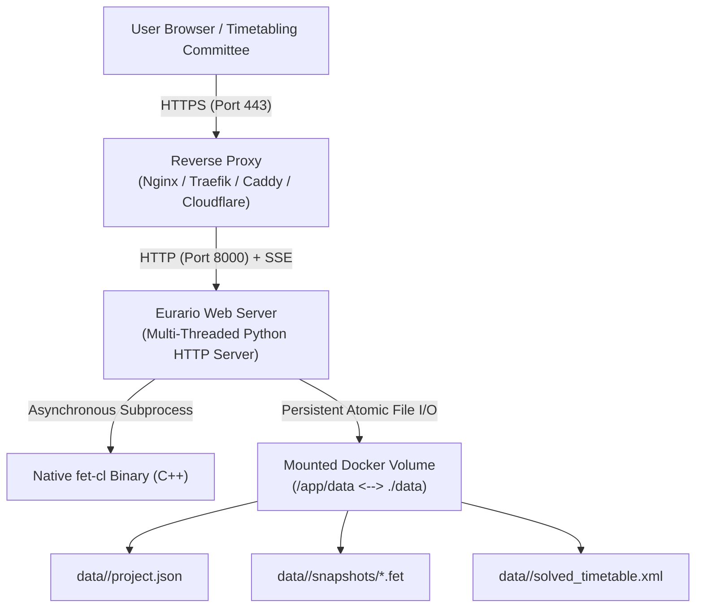

# 🐳 Docker Installation & Deployment

Eurario is published as a multi-architecture container image (**Linux `amd64`** for Intel/AMD servers and **Linux `arm64`** for Apple Silicon, Raspberry Pi 5, and ARM cloud servers) on the official Docker Hub registry:

> 📦 **Official Docker Hub Image**: [`carlorigoni/eurario:latest`](https://hub.docker.com/r/carlorigoni/eurario)

---

## 1. System Requirements & Architecture

* **Supported Operating Systems**: Ubuntu Server 22.04/24.04 LTS, Debian 12, Rocky Linux / AlmaLinux 9, Synology DSM 7+ (Container Manager), QNAP QuTS, macOS, and Windows with Docker Desktop.
* **Hardware Architectures**:
  * `x86_64 / amd64` (Dedicated servers, VMware ESXi VMs, Proxmox VE, cloud VPS).
  * `aarch64 / arm64` (ARM cloud instances, Apple Silicon M-Series, Raspberry Pi 5 with 4GB+ RAM).
* **Software Prerequisites**: Docker Engine 24+ and Docker Compose v2+.
* **Recommended Sizing**: Minimum 1 vCPU and 1 GB of RAM (2 GB recommended for institutions with 100+ teachers running intensive solver runs).



---

## 2. Quickstart with Docker Compose

Create a dedicated directory on your server:

```bash
mkdir -p /opt/eurario && cd /opt/eurario
```

Create the `docker-compose.yml` file:

```yaml
version: '3.8'

services:
  eurario:
    image: carlorigoni/eurario:latest
    container_name: eurario-app
    restart: unless-stopped
    ports:
      - "8000:8000"
    volumes:
      - ./data:/app/data
    environment:
      - PORT=8000
      - PYTHONUNBUFFERED=1
      # Optional: Google Workspace OAuth 2.0 Single Sign-On
      # - GOOGLE_CLIENT_ID=your-client-id.apps.googleusercontent.com
      # Optional: Auto-approved superadmin email address on initial launch
      # - INITIAL_ADMIN_EMAIL=principal@school.edu
    healthcheck:
      test: ["CMD-SHELL", "python3 -c \"import urllib.request; urllib.request.urlopen('http://localhost:8000/api/summary')\""]
      interval: 30s
      timeout: 10s
      retries: 3
      start_period: 10s
```

Start the application daemon:

```bash
docker compose up -d
```

Verify status and container logs:

```bash
docker compose ps
docker compose logs -f
```

The application will immediately be accessible at: `http://server-ip:8000/`.

---

## 3. Environment Variable Reference

| Variable | Default | Description |
| :--- | :---: | :--- |
| `PORT` | `8000` | Internal HTTP web server listening port. |
| `PYTHONUNBUFFERED` | `1` | Forces unbuffered stdout/stderr streaming for clean container logging. |
| `GOOGLE_CLIENT_ID` | *(unset)* | Google Workspace OAuth 2.0 Client ID. When omitted, enables standalone mode. |
| `INITIAL_ADMIN_EMAIL` | *(unset)* | Email address automatically granted Superadmin status on first authentication. |

---

## 4. Data Persistence & Backup Strategy

All school master data, teaching allocations, snapshots, and calculated schedules reside in the mounted `./data` volume.

### Directory Layout:
```text
/opt/eurario/data/
├── default/                         # Default school tenant
│   ├── project.json                 # Primary database (teachers, classes, constraints)
│   ├── solved_timetable.xml         # Latest FET solver result
│   └── snapshots/                   # Historical milestone snapshots
│       ├── 20261027_baseline.fet
│       └── 20261027_final.fet
└── technical_college/               # Additional school tenants (Multi-Tenant)
    └── project.json
```

### Automated Nightly Backup Cron
Because data is stored in standard JSON and XML files, live backups do not require complex database locking:

```bash
# Add to root crontab (crontab -e) to execute nightly at 02:00 AM
0 2 * * * tar -czvf /backup/eurario-$(date +\%F).tar.gz -C /opt/eurario data/
```

To restore a backup archive:
```bash
docker compose stop
tar -xzvf /backup/eurario-2026-10-27.tar.gz -C /opt/eurario/
docker compose start
```

---

## 5. Reverse Proxy & SSL / HTTPS Termination

To enable HTTPS and ensure Google OAuth functionality, deploy Eurario behind a reverse proxy configured with **Server-Sent Events (SSE)** unbuffering.

### A. Nginx Configuration (Recommended)
Crucially, proxy buffering must be disabled for `/api/solver/stream`:

```nginx
server {
    listen 80;
    server_name timetable.school.edu;
    return 301 https://$host$request_uri;
}

server {
    listen 443 ssl http2;
    server_name timetable.school.edu;

    ssl_certificate /etc/letsencrypt/live/timetable.school.edu/fullchain.pem;
    ssl_certificate_key /etc/letsencrypt/live/timetable.school.edu/privkey.pem;
    ssl_protocols TLSv1.2 TLSv1.3;

    location / {
        proxy_pass http://127.0.0.1:8000;
        proxy_set_header Host $host;
        proxy_set_header X-Real-IP $remote_addr;
        proxy_set_header X-Forwarded-For $proxy_add_x_forwarded_for;
        proxy_set_header X-Forwarded-Proto $scheme;

        # Crucial for live FET solver SSE log streaming
        proxy_http_version 1.1;
        proxy_set_header Connection '';
        proxy_buffering off;
        proxy_cache off;
        chunked_transfer_encoding off;
        proxy_read_timeout 600s;
    }
}
```

### B. Caddy Configuration
For automatic Let's Encrypt certificates with minimal syntax:

```caddyfile
timetable.school.edu {
    reverse_proxy localhost:8000 {
        header_up Host {host}
        header_up X-Real-IP {remote_host}
    }
}
```

### C. Secure Zero-Trust Publishing via Cloudflare Tunnel
For institutions on dynamic IP connections or behind strict institutional firewalls with no inbound open ports:

```bash
# 1. Install the cloudflared daemon
curl -L --output cloudflared.deb https://github.com/cloudflare/cloudflared/releases/latest/download/cloudflared-linux-amd64.deb
sudo dpkg -i cloudflared.deb

# 2. Authenticate and map your school subdomain
cloudflared tunnel login
cloudflared tunnel create eurario-school
cloudflared tunnel route dns eurario-school timetable.school.edu

# 3. Start the tunnel daemon
cloudflared tunnel run --url http://localhost:8000 eurario-school
```
Your timetable application is now securely accessible globally over HTTPS with zero inbound ports exposed to the public internet.
