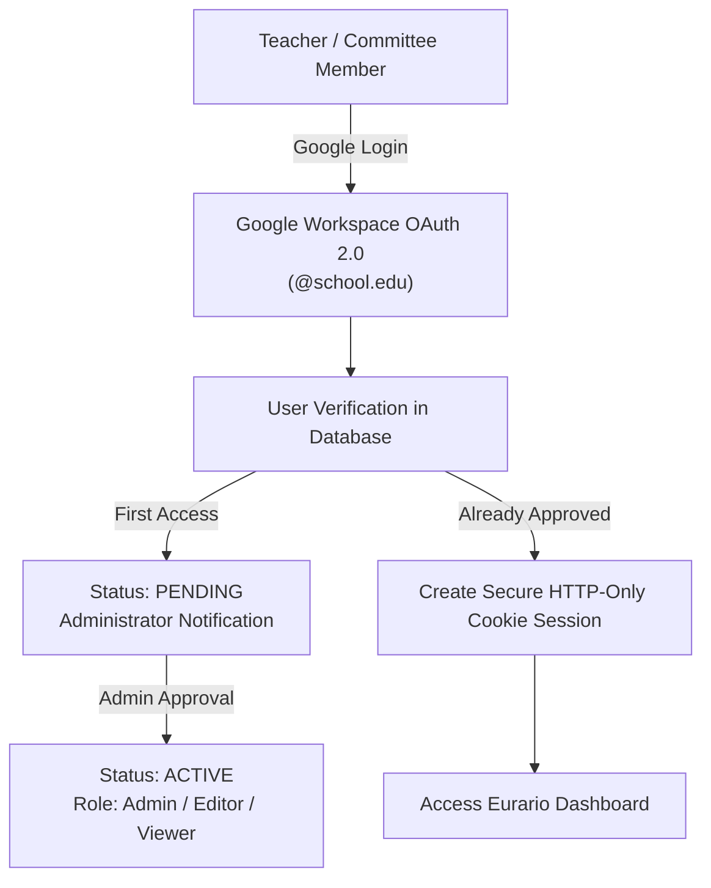
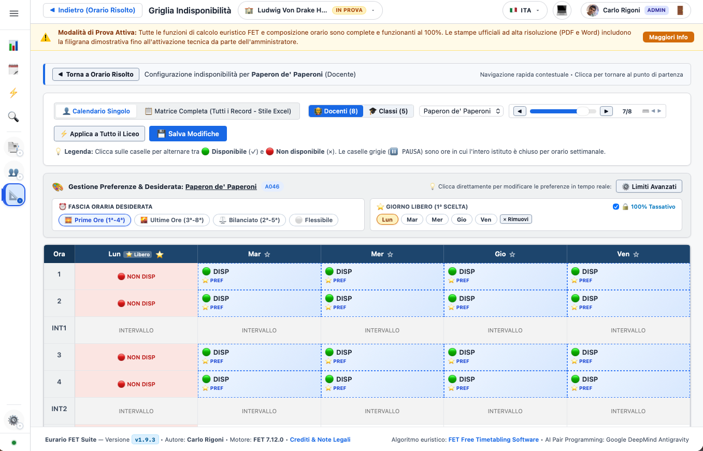
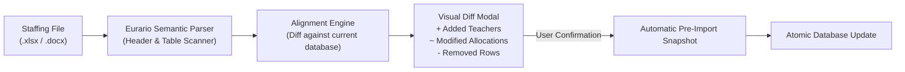

# 🚀 Getting Started & Master Data Configuration

This guide walks the school timetabling committee through the essential first steps in Eurario, from authentication and multi-school isolation to detailed master data management.

---

## 1. Authentication & Role-Based Access Control (RBAC)

Eurario incorporates an institutional access control system designed to safeguard sensitive educational data in compliance with GDPR standards:

* **Google Workspace Single Sign-On**: Users authenticate using their official institutional accounts (e.g. `name.surname@school.edu`). No local passwords need to be set or maintained.
* **Protected Registration Workflow**: When logging in with Google for the first time, accounts are placed in `pending` status. The system administrator receives an alert in the administration console and can approve access with the appropriate permissions (`admin`, `editor`, `viewer`).
* **Standalone / Demo Mode**: If `GOOGLE_CLIENT_ID` is omitted in the Docker environment, Eurario automatically activates standalone mode, granting immediate access to the default school without requiring cloud tokens.

---

## 2. Multi-School Architecture (Multi-Tenant)

Eurario natively supports **multiple independent schools** inside a single running instance:

* **Strict Data Isolation**: Each school's data is housed in its own isolated directory under `data/<school_id>/`, containing `project.json`, historical snapshots (`snapshots/`), and the latest solved timetable (`solved_timetable.xml`).
* **Instant Switching**: Through the **Schools** dropdown in the top navigation bar, authorized administrators can switch between institutes or spin up a new blank school dataset.
* **Optimistic Concurrency Control (OCC)**: Every database mutation increments a `data_version` counter. If two committee members simultaneously modify data for the same institution, Eurario intercepts the conflict, prevents data overwrite, and presents a visual comparison modal showing the concurrent changes.

---

## 3. Buildings & Rooms Management

Before defining classes and teachers, physical school spaces must be configured:

### A. School Buildings (Plessi)
For institutions operating across multiple sites (e.g., *Main Campus* and *Branch Campus*):
* **Building Name**: Official name of the campus.
* **Short Code**: Brief identifier (e.g., `C` for Central, `B` for Branch), rendered on timetable cards and teacher boards.
* **Travel Time**: Estimated travel duration in minutes between buildings. FET uses this parameter to prevent scheduling back-to-back lessons across different campuses without sufficient commuting time.

### B. Rooms & Laboratories (Rooms)
* **Room Name**: e.g. `Room 101`, `Computer Lab 1`, `Main Gymnasium`.
* **Associated Building**: Physical campus location.
* **Student Capacity**: Maximum seating capacity. Eurario checks student headcount against room capacity.
* **Room Type**: Standard, Gymnasium, Computer Lab, Science Lab, Art Studio.
* **"Lab or Gym" Flag (`is_lab_or_gym`)**: Flags the room as a limited-availability, shared facility for the timetable solver and print templates.

---

## 4. Classes & Articulated Groups

Classes represent the student groups for which FET will generate a continuous, gap-free weekly schedule.

### A. Standard Class Parameters
* **Class Name**: Standard denomination (e.g., `1A`, `2B`, `3CSA`, `5BL`).
* **Student Headcount**: Number of enrolled students (used for room capacity validation).
* **Home Room (`base_room`)**: Default regular classroom permanently assigned to the class (`ConstraintStudentsSetHomeRoom`).
* **Default Building**: The home campus of the class.
* **Weekly Schedule Presets**: Quickly apply standard high school schedules (5-day or 6-day week schedules, automatically barring afternoon periods or configuring required afternoon return sessions).

### B. Articulated Classes & Subgroups
For courses where a class splits into multiple tracks (such as second foreign languages or technical specializations):
* **Subgroups / Articulations**: Eurario creates linked child entities (e.g., `3A_FRA` and `3A_SPA` for French and Spanish, or `4A_MECH` and `4A_AUTO` for technical tracks).
* **Simultaneous Scheduling**: During articulated hours, both subgroups attend class during the very same period in separate rooms without generating schedule conflicts for the parent class.

---

## 5. Subjects & Print Abbreviations

Subject management in Eurario balances pedagogical requirements with typographic print considerations:

  
  
Figure 2.1: Subject configuration modal, ministerial competition class (CDC), print abbreviation, and preferred time slots.

### Detailed Subject Parameters:
* **Full Name**: Complete academic title (e.g., *Natural Sciences, Chemistry and Biology*).
* **Print Short Name (`short_name`)**: Optional compact label for official printouts. When provided (e.g., `MATH`, `PHYS`, `SCI`, `ENG`), it is rendered in Word (.docx) and PDF timetable cells, avoiding awkward line breaks. If omitted, Eurario automatically generates a smart abbreviation.
* **Competition Code (CDC)**: Reference ministerial code (e.g., `A012`, `A027`, `A048`).
* **Preferred Time Slot (`pref_hours`)**:
  * `PRIME`: Prioritizes scheduling during periods 1 to 3 (ideal for written tests, math, and high-focus subjects).
  * `ULTIME`: Favors late morning or afternoon periods (ideal for Physical Education, art, and practical labs).
  * `INDIFFERENTE`: No specific time preference.
* **Afternoon Exclusion (`no_rientri`)**: Hard constraint prohibiting the subject from 7th or 8th period afternoon slots.

---

## 6. Teacher Profiles & Contractual Rules

Every teacher profile in Eurario is linked to strict contractual rules:

* **Full Name & Short Label (`short_name`)**: Eurario automatically generates the official typographic initials for compact boards (e.g., `ROSSI M.`, `BIANCHI L.`).
* **Contract Workload (`target_hours`)**:
  * Standard full-time schedule: **18 hours/week** (in secondary education).
  * Part-time contracts: 8, 9, 10, 12, 14, or 15 hours/week.
* **Contract Type (`contract_type`)**: `intera` (full), `part-time`, `spezzone` (hour block).
* **Active Working Days (`min_days` & `max_days`)**:
  * Full-time: typically 5 days per week (with 1 day off out of 6).
  * Part-time: computed automatically based on workload (e.g. 9 hours over 2-3 days; 12 hours over 3-4 days).
* **External Shared Schedule (COE - Cattedra Orario Esterna)**:
  * Active `is_coe` flag.
  * External school completion hours (`coe_hours`) and designated external working days (`coe_days`).
  * Eurario deducts external hours from the internal target and strictly blocks external days in the solver XML.
* **Allowed Buildings (`allowed_buildings`)**: Restricts the teacher to specific campus locations.
* **Interactive Unavailability Matrix**:
  * Weekly grid (days x hours) to toggle contractual days off or specific periods unavailable for administrative tasks.
  * FET converts these selections into 100% hard constraints (`<ConstraintTeacherNotAvailableTimes>`).

  
  
Figure 2.2: Teacher profile and weekly matrix for rapid day-off and hourly unavailability configuration.

---

## 7. Automated Organico Ingestion from Excel or Word

Instead of entering hundreds of teacher assignments manually, Eurario includes a powerful data ingestion engine:

1. **Excel (`.xlsx`) and CSV Import**: Ingestion of structured spreadsheets with standard columns (*Teacher, Competition Code, Class/Group, Subject, Weekly Hours*).
2. **Official Word (`.docx`) Model**: Download a preformatted Word template, complete it with the administration, and upload it directly.
3. **Pre-Import Integrity Check (`analyze_cattedre_alignment`)**:
   * Highlights added teachers in green, modified hours in yellow, and deleted assignments in red.
   * Validates total class hours against curriculum standards (e.g., 27h/week for early scientific high school, 30h/week for senior years).
4. **Automatic Safety Snapshot**: Automatically creates a rollback point (*"Pre-Import Organico"*) before applying batch updates.
