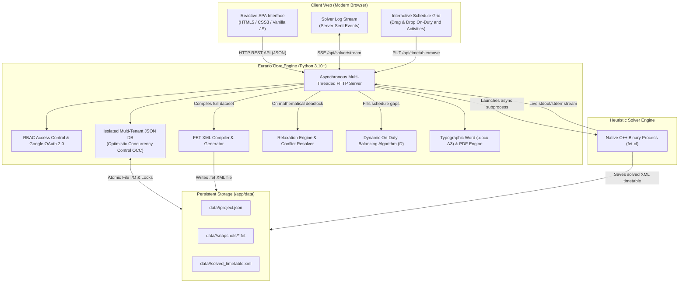

# 🎓 Eurario — Official Documentation

Welcome to the technical and operational documentation of **Eurario**, the modern, open-source school timetabling suite specifically designed for modeling, mathematical solving, optimization, and publishing of high school schedules.

Eurario combines a responsive, collaborative web interface (inspired by Material Design 3 and Google Classroom) with the unmatched performance and dependability of the native **FET** (*Free Timetabling Software*) heuristic engine, created by Liviu Lalescu and Volker Dirr.

---

## 🧭 Documentation Roadmap

  <a href="../getting-started/" class="eurario-card">
    <h3>🚀 Getting Started & Master Data</h3>
    
Secure authentication via Google Workspace, multi-school management, teacher profiles, classes, split groups, subjects with print abbreviations, rooms, and buildings.

  </a>

  <a href="../user-guide/" class="eurario-card">
    <h3>📖 User Guide & Real-World Use Cases</h3>
    
Step-by-step chronological user guide and 10 concrete institutional use cases: part-time, shared COE, co-teaching, language splits, and relaxation diagnostics.

  </a>

  <a href="../timetable-flow/" class="eurario-card">
    <h3>⚡ Timetable Generation & Optimization</h3>
    
Teaching assignments, automatic sub-activity block splitting (2+1+1), asynchronous solver execution with live SSE streaming, Relaxation Engine diagnostics, and on-duty hour balancing.

  </a>

  <a href="../cross-reference/" class="eurario-card">
    <h3>🔬 Parameters & FET Cross-Reference</h3>
    
Exhaustive comparative mapping between Eurario's pedagogical interface settings and the generated C++ FET XML constraints (time, space, and institutional rules).

  </a>

  <a href="../docker-deploy/" class="eurario-card">
    <h3>🐳 Docker Installation & Deployment</h3>
    
Quick on-premise deployment on Linux x86/ARM servers, Docker Compose, Synology NAS, reverse proxying with Nginx/Traefik, and HTTPS via Cloudflare Tunnel.

  </a>

---

## 🏛️ System Architecture

Eurario is architected with a modular, lightweight containerized stack, completely independent of heavy external database services:

---

## 🌟 Key Features & Institutional Compliance

Eurario was engineered around real-world logistical, contractual, and educational constraints of secondary schools:

### 1. Strict Contractual Compliance
* **Standard Workloads (18 hours)**, **Part-Time Schedules** (2 to 5 working days per week), and **Hour Blocks**.
* **External Shared Schedules (COE)**: Explicit configuration of external days and hours for teachers split across multiple schools, automatically subtracted from internal target hours.
* **Guaranteed Contractual Day Off**: Enforced as a strict hard constraint (100% weight in FET).
* **Gap Hours Minimization**: Strict control over free windows between teaching periods (e.g., maximum 1 hour per day, 2 hours per week).
* **Minimum Daily Hours**: Enforcing minimum teaching thresholds (e.g., at least 2 hours per day) to avoid trips for a single lecture.

### 2. Advanced Curriculum & Articulated Groups
* **Automatic Sub-Activity Block Splitting**: Converts total weekly hours into sound pedagogical units (`2+1+1` for 4 hours, `2+1` for 3 hours, `2+2+1+1` for 6 hours, `2` for Physical Education or laboratory sessions).
* **Macro-Subjects & Merged Activities**: Unified management for composite disciplines (e.g., *Literature & History* or *Mathematics & Physics*) with separate subject designations on final printouts.
* **Articulated & Split Classes**: Full support for bilingual or specialized tracks (*French / Spanish / German* or technical specializations like *Mechanics / Robotics*) running simultaneously in separate rooms.
* **Preferred Time Slots**: Direct incentives for early morning periods (*PRIME*) for cognitively demanding subjects or late/afternoon slots (*ULTIME*) for labs and sports.
* **Afternoon Period Exclusions**: Direct flags to prevent theoretical classes from being scheduled during 7th and 8th hour afternoon periods.

### 3. Multi-Building Logistics & Shared Facilities
* **Main Building & Annexes (Plessi)**: Native support for teachers commuting between buildings, incorporating travel times and capping daily building changes.
* **Specialized Rooms & Gyms**: Manages capacity-restricted spaces, half-court gyms, and computer/science labs shared across multiple classes.

### 4. Dynamic On-Duty & Substitute Balancing ("D")
* **Smart Greedy Placement Algorithm**: Automatically fills teacher schedule gaps with on-duty reserve hours ("D") to maximize cover during peak absence periods.
* **Interactive Drag & Drop**: Freely reposition on-duty hours directly inside the master grid with real-time conflict checking.
* **Custom Duty Labels**: Assign dedicated roles such as *Library Duty*, *Lab Support*, or *Administration*.

### 5. Typographic Exports & Collaboration
* **Official Word (.docx) Master Teacher Board**: A3 Landscape layout fully compliant with institutional regulations, featuring repeated table header rows (`tblHeader`), anti-row-split styling (`cantSplit`), dynamic column width adjustments, and highlighted on-duty hours.
* **Typographic Class Timetables**: Rendered in high-contrast pastel palettes or monochrome *Toner-Save* format for high-volume school printing.
* **Optimistic Concurrency Control (OCC)**: Built-in `data_version` tracking prevents accidental overwrites when multiple timetable committee members work simultaneously.

---

## 🖥️ User Interface Overview

Unlike legacy timetabling applications burdened with nested dialogs, Eurario presents a unified, live web dashboard:

  
  
Figure 1.1: Main teaching assignments dashboard and automatic block splitting in Eurario.

---

## 📜 License & Project Credits

Eurario is free and open-source software distributed under the terms of the **GNU Affero General Public License v3 (AGPLv3)**.

* **Architecture, Full-Stack Design & Engineering**: [Carlo Rigoni](https://github.com/carlorigoni)
* **Timetabling Methodology & Mentorship**: Federico Rettore
* **FET Heuristic Timetabling Engine**: Liviu Lalescu and Volker Dirr ([Official FET Website](https://lalescu.ro/liviu/fet/))
* **Official GitHub Repository**: [github.com/carlorigoni/eurario](https://github.com/carlorigoni/eurario)
