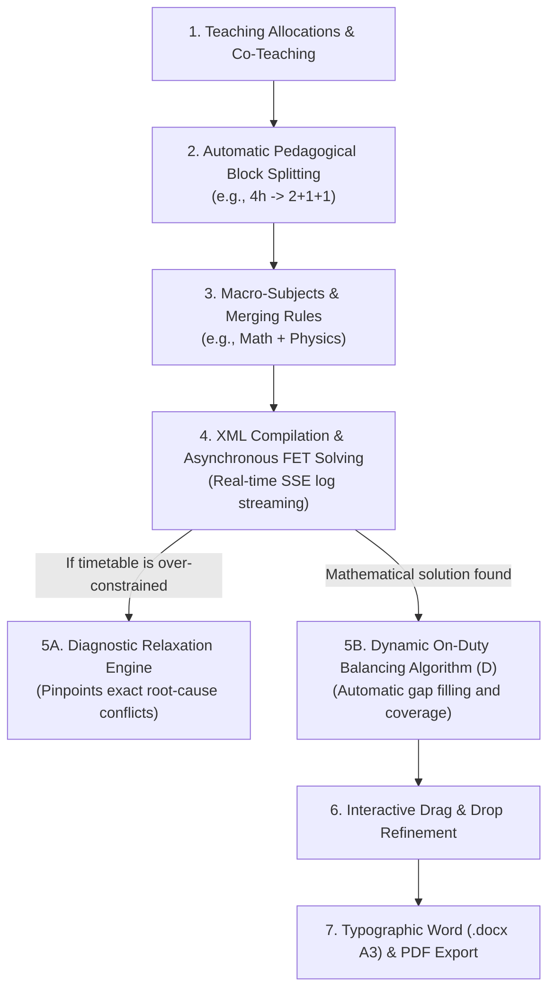
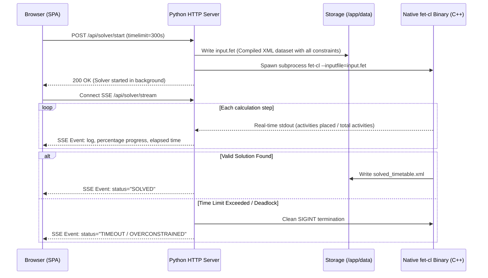
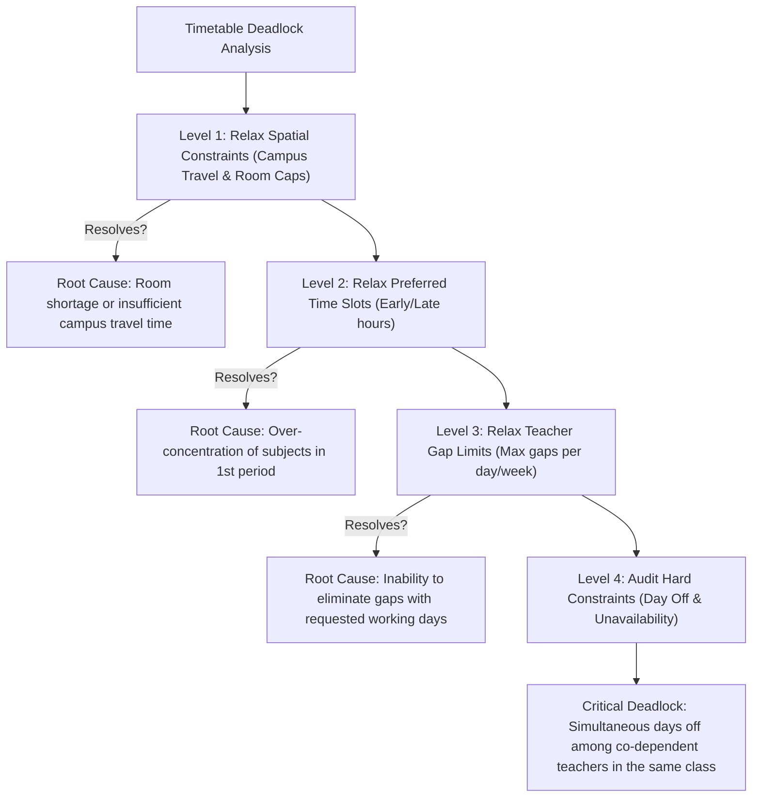
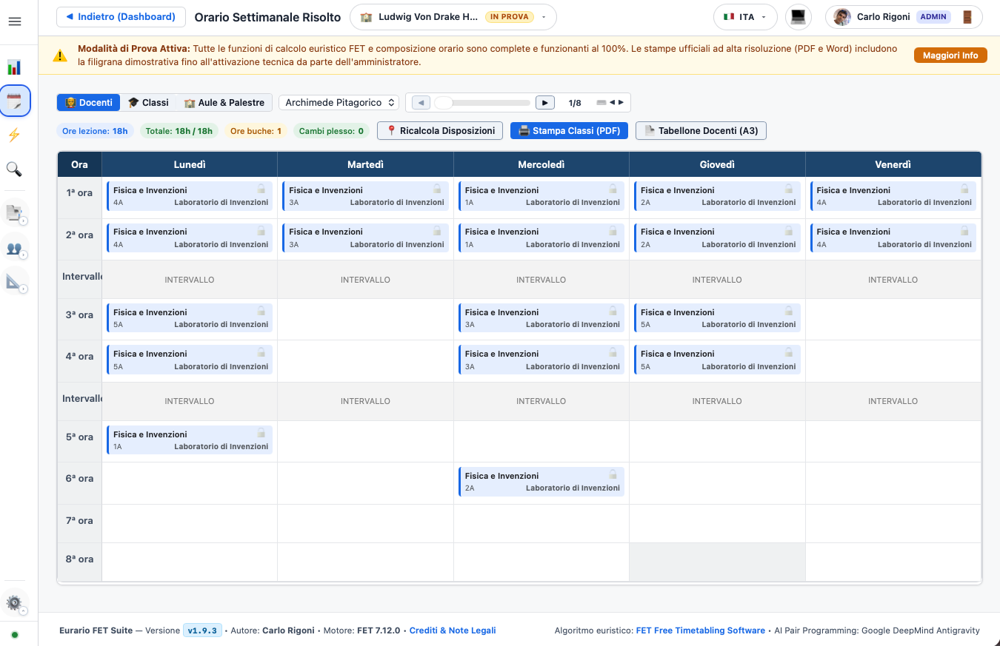

# ⚡ Timetable Generation, Solving & Optimization

Constructing an optimal school timetable requires mathematically balancing strict contractual constraints (availability, rest intervals, travel between buildings) against pedagogical goals (balanced weekly distribution, consecutive lab sessions, early hours for tests).

In Eurario, this process is structured across **6 consecutive, reversible, and fully auditable phases**.

---

## 1. Teaching Allocations & Pedagogical Block Splitting

In Eurario, a **Teaching Allocation (Cattedra)** represents the assignment between one or more teachers (including co-teaching), a class or articulated group, and a subject for a set number of weekly hours.

### The "Sub-Activity Block Splitting" Model
The FET mathematical engine does not schedule abstract bulk hours; rather, it places discrete **atomic sub-activities**, each possessing an exact duration (a single 1-hour lesson, 2 consecutive hours for written exams or labs, or 3 hours for technical drawing).

Eurario implements the heuristic algorithm `compute_fallback_blocks(total_hours, subject)` to automatically split weekly workloads according to established pedagogical standards:

| Weekly Hours | Default Block Split | Educational Rationale & Alternatives |
| :---: | :---: | :--- |
| **1 hour** | `1` | Ethics / Religious Education, Homeroom period |
| **2 hours** | `2` *(or `1+1`)* | `2` for Physical Education or Labs; `1+1` for oral lectures |
| **3 hours** | `2+1` | Foreign Languages, History, Philosophy |
| **4 hours** | `2+1+1` *(or `2+2`)* | `2+1+1` for Mathematics/Physics; `2+2` for science labs |
| **5 hours** | `2+1+1+1` *(or `2+2+1`)* | Classical Languages (Latin/Greek), Literature |
| **6 hours** | `2+2+1+1` | Integrated Humanities (Literature and History) |
| **7 hours** | `2+2+2+1` | Composite blocks (Math & Physics, Literature & Classics) |
| **8 hours** | `2+2+2+2` | Vocational workshop modules with double lab sessions |

### Custom Block Overrides & Feasibility Checking (`check_cattedra_feasibility`)
The timetabling committee can override any split at any time by directly typing the desired block sequence (e.g., `1+1+1` instead of `2+1`). Eurario immediately verifies two key requirements:
1. **Hour Sum Consistency**: Ensures that the arithmetic sum of the sub-activities matches the total assigned hours.
2. **Teacher Working Days Feasibility**: If a teacher works a part-time contract spanning only 3 days per week, but their subject is split into 4 single-hour blocks (`1+1+1+1`), the system alerts the committee before running FET, preventing an unsolvable mathematical state.

---

## 2. Macro-Subjects & Activity Merging Rules

In secondary schools, single teaching positions often encompass multiple formally distinct disciplines:
* **Italian Literature, History and Geography** (7 total hours).
* **Mathematics and Physics** (7 or 8 total hours in senior science tracks).
* **Philosophy and History** (5 or 6 total hours).

Through the **Merging Rules (Accorpamenti)** module:
1. Eurario automatically identifies potential merge candidates (`get_accorpamenti_candidates`) where the same teacher covers compatible subjects in the same class.
2. Applying the rule groups these separate activities into a single macro-activity with an optimized block sequence (e.g., `2+2+2+1`), avoiding redundant or competing constraints.
3. On official master printouts and grade sheets, Eurario retains individual subject identities by properly labeling each period.

---

## 3. XML Compilation & Asynchronous FET Solving

When the committee launches timetable generation, Eurario initiates an asynchronous, multi-threaded pipeline:

### Execution Highlights:
* **Non-Blocking Operation**: The native C++ solver `fet-cl` runs in a dedicated background worker. Committee members can freely browse or configure other modules without interrupting the run.
* **Real-Time SSE Streaming**: The Eurario solver console receives live progress updates (placed activities, iterations per second, elapsed time).
* **Graceful Abort**: Clicking the *"Stop"* button sends a graceful `SIGINT` signal to `fet-cl`, allowing it to cleanly dump the best partial timetable generated so far before exiting.

---

## 4. Diagnostic Relaxation Engine (Conflict Analysis)

If FET fails to find a complete solution within the allocated time limit, the timetable is almost certainly mathematically over-constrained.

Rather than leaving the committee with generic errors, Eurario's **Relaxation Engine** systematically investigates the deadlock by temporarily relaxing secondary constraint layers:

The diagnostic report explicitly names the affected teachers, classes, or rooms, suggesting minimal targeted remedies (e.g., *"Allow 1 additional gap hour for Prof. Bianchi"* or *"Shift Dr. Neri's day off from Wednesday to Friday"*).

---

## 5. Dynamic On-Duty & Reserve Balancing Algorithm ("D")

Once all curricular teaching activities are placed by FET, teachers with fewer than 18 teaching hours have remaining contracted hours designated for internal relief and substitution (*Disposizioni* or *On-Duty Reserve*).

Eurario provides an automated greedy placement algorithm (`place_disposizioni_in_timetable`):

### How the Algorithm Works:
1. **Residual Computation**: For each teacher, the system computes:
   $$\text{On-Duty Hours} = \text{target\_hours} - \sum \text{assigned curricular hours}$$
2. **Priority 1 — Gap Plugging**: The algorithm first searches for free periods sandwiched between two teaching hours for the same teacher. Placing an on-duty period in that gap eliminates dead time and optimizes the teacher's presence on campus.
3. **Priority 2 — Natural Clustered Placement**: If a teacher has no gaps, the on-duty period is placed directly before or after their active classes, adhering to maximum daily teaching limits.
4. **Priority 3 — Global School Coverage**: The algorithm balances total reserve staff across every single period of the week, avoiding uncovered periods and ensuring robust substitute capacity.

---

## 6. Interactive Grid, Snapshots & Master Exports

  
  
Figure 3.1: Weekly timetable board with class or teacher views, automated on-duty placement (D), and drag & drop.

### Professional Operational Tools:
* **Interactive Drag & Drop**: Any lesson or on-duty slot can be manually dragged to a new position on the grid with immediate collision checking.
* **Custom Duty Labeling (`custom_desc`)**: Assign dedicated roles to reserve hours (e.g., *Library Duty*, *Lab Supervision*, *Special Needs Assistance*).
* **Activity Pinning (`toggle_activity_lock`)**: Lock an activity to a specific day and period to protect it from subsequent rebalancing or auto-generation cycles.
* **Named Snapshots**: Save milestone versions (e.g., *"Official Fall Schedule"*, *"Draft 2 - Afternoon Returns"*) with one-click rollback or raw `.fet` file download.
* **Word (.docx) Master Teacher Board (A3 Landscape)**:
  * Full institutional compliance with repeated table headers across pages (`tblHeader`).
  * Anti-split row styling (`cantSplit`) ensuring readable physical printouts.
  * Amber color-coded highlighting for on-duty hours ("D").
* **Class Timetables (PDF & HTML)**:
  * High-contrast pastel color coding by subject.
  * High-volume, toner-friendly monochrome format (*Toner-Save*).
