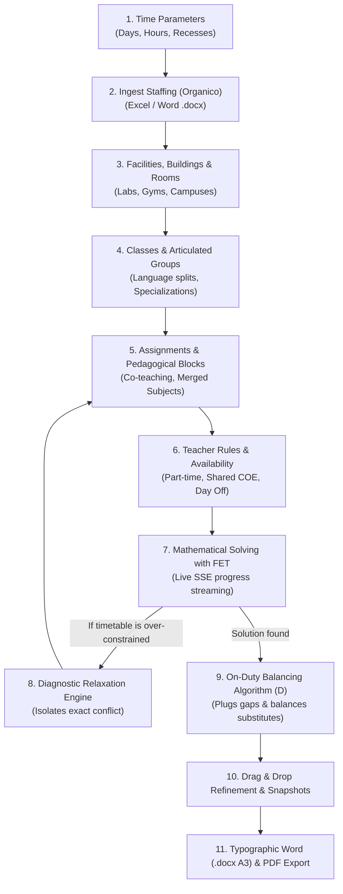

# 📖 Comprehensive User Guide & Real-World Use Cases

Drafting the official master timetable for secondary schools is one of the most demanding operational challenges for school principals and timetabling committees. It requires harmonizing strict contractual guidelines, educational requirements for students, physical resource limitations (laboratories, gymnasiums, campus annexes), and teachers split across multiple locations or working on part-time contracts.

This guide outlines the **chronological end-to-end operational workflow** and explores **10 concrete real-world use cases**, detailing how to model and resolve them inside Eurario.

---

## 🗺️ End-to-End Operational Workflow

---

### Step 1: Institutional Time Grid Setup
Before adding staff or students, configure the school's weekly time parameters:
1. Navigate to **Timetable Settings**.
2. **School Days**: Choose between a 5-day week (Monday–Friday) or a 6-day week (Monday–Saturday).
3. **Daily Lesson Periods**: Define the standard daily periods (e.g., 6 regular periods: $08:00 - 14:00$).
4. **Afternoon Sessions (Optional)**: If the school operates on a 5-day week with afternoon returns for technical tracks or senior high schools, enable periods 7 and 8.
5. **School Recesses**: Specify after which period recess takes place (e.g., after period 3) to compile the `<ConstraintBreakTimes>` tag in FET.

---

### Step 2: Staffing Ingestion & Allocation Alignment
Instead of manually typing hundreds of teacher names and subjects:
1. Under **Snapshots & Staffing**, select **Upload Staffing File**.
2. Upload the Excel (`.xlsx`), CSV, or official Word (`.docx`) template prepared by the administration.
3. The alignment engine (`analyze_cattedre_alignment`) runs a diff check against the active database:
   * 🟢 **Green**: Newly added teachers and course allocations.
   * 🟡 **Yellow**: Allocations with modified weekly hours.
   * 🔴 **Red**: Removed allocations.
4. Click **Apply Changes with Snapshot**: Eurario automatically creates a pre-import rollback snapshot before updating the school database.

---

### Step 3: Physical Facilities & Campus Logistics
1. **Campuses (Buildings)**: For multi-site schools (e.g., *Main Campus* and *Branch Annex*), define both entities and set the **road travel time** (e.g., 15 minutes).
2. **Standard Classrooms**: Add regular classrooms and assign them to their respective campus buildings.
3. **Capacity-Restricted Spaces**: Add gymnasiums, computer labs, and science laboratories with the **Lab or Gym** flag (`is_lab_or_gym`) enabled so FET treats them as scarce, contested resources.

---

### Step 4: Classes, Tracks & Articulated Groups
1. Define standard classes (e.g., `1A`, `2B`, `3CSA`) specifying:
   * Student headcount (validated against room seating capacities).
   * **Home Room**: The classroom permanently assigned to that cohort.
2. For classes that split into elective subjects (such as bilingual language groups or technical specializations), Eurario generates linked sub-entities (`3A_FRA`, `3A_SPA`).

---

### Step 5: Allocations, Pedagogical Blocks & Merging
1. Assign the teacher (or multiple teachers for co-teaching), student class, subject, and weekly hours to each allocation.
2. Eurario immediately computes the optimal sub-activity block split (`compute_fallback_blocks`):
   * 4 hours of Mathematics $\rightarrow$ `2+1+1` (one 2-hour block and two 1-hour lectures).
   * 6 hours of Humanities $\rightarrow$ `2+2+1+1`.
   * 2 hours of Physical Education $\rightarrow$ `2` (consecutive double period in the gym).
3. **Merging Rules**: In the *Merging Rules* module, combine compatible subjects taught by the same teacher in the same class (e.g., *Mathematics and Physics* 7h $\rightarrow$ `2+2+2+1`).

---

### Step 6: Teacher Contractual Constraints & Availability
1. Verify each teacher's target hours (`target_hours`: 18h full-time, or part-time).
2. Set minimum and maximum active days (`min_days` and `max_days`).
3. In the **weekly availability grid**, mark with a click:
   * The contractual **day off**.
   * Hourly unavailabilities for special duties, nursing leave, or administrative commitments.
4. For teachers shared with external schools, enable the **COE** toggle and designate external hours and days.

---

### Step 7: Mathematical Timetable Solving with FET
1. Open the **Timetable Solver** view.
2. Set the desired timeout (e.g., 300 seconds or unlimited).
3. Click **Start FET Solver**:
   * The native C++ binary `fet-cl` launches asynchronously in the background.
   * The live SSE progress stream reports placed activities, attempts per second, and elapsed time in real time.
   * You can stop the run at any point to save the best partial schedule generated so far.

---

### Step 8: Conflict Diagnosis with the Relaxation Engine
If the timetable is mathematically over-constrained:
1. FET halts when unable to place all activities.
2. Eurario's **Relaxation Engine** initiates a 4-level hierarchical conflict diagnosis.
3. The report isolates the bottleneck (e.g., *"Prof. Neri and Prof. Gialli both request a day off on Wednesday in class 4B, depleting available hours"*).
4. Apply the recommended adjustment and re-run the solver.

---

### Step 9: Smart On-Duty Placement Algorithm ("D")
Once all curricular lessons are successfully scheduled:
1. Teachers with fewer than 18 teaching hours have reserve hours for substitutions and relief duty.
2. Click **Place On-Duty Automatically**:
   * The proprietary algorithm finds schedule gaps ("holes") in the teacher's day and plugs them first, eliminating dead time.
   * It balances the total substitute teacher presence across all periods of the week.

---

### Step 10: Interactive Drag & Drop Refinement & Snapshots
1. On the master timetable grid, drag and drop any period to fine-tune placement:
   * If an adjustment causes a collision (e.g., room double-booking), Eurario alerts you instantly.
2. Pin final activities with the lock icon (`locked`).
3. Save a **Named Snapshot** (e.g., *"Fall Baseline - Approved"*).

---

### Step 11: Official Word (.docx) & PDF Export
1. Click **Official Printouts**.
2. Export **Master Teacher Board (.docx)**:
   * Generated in **A3 Landscape** format compliant with institutional inspection standards.
   * Repeated table header rows across all printed pages.
   * Highlighted amber styling for on-duty reserve hours ("D").
3. Export **Class Timetables (PDF)**:
   * Rendered with high-contrast pastel subject palettes or monochrome *Toner-Save* format for student noticeboards.

---

## 💼 In-Depth Real-World Use Cases (Secondary School & Official FET Manual)

Before examining specific scenarios, it is essential to understand the **algorithmic architecture and philosophy** established in the [Official FET Manual](https://www.timetabling.de/manual/FET-manual.en.html), which is seamlessly embedded within Eurario's solving engine.

### 🧠 The Three Algorithmic Pillars of the Official FET Manual

#### 1. "The Golden Rule" and Incremental Generation
School timetabling is a known NP-complete mathematical problem. The single most common mistake made by timetabling committees is loading 100% of all constraints, individual preferences, and soft teacher requests on the very first solving attempt. When the calculation fails to converge, isolating which exact rule or combination caused the bottleneck becomes nearly impossible.
* **Phase A (Structural Baseline 100%)**: Input strictly non-negotiable entities: Days, Hours, Classes, Teachers, Curricular allocations, Hard unavailabilities (statutory days off, part-time schedules), and Mandatory room reservations (specialized labs and gymnasiums). Verify that this baseline converges within seconds. If it fails, an inescapable arithmetic flaw exists in your staffing allocations (e.g., total assigned hours exceed available time slots).
* **Phase B (Pedagogical Quality & Well-Being)**: Introduce distribution constraints across the week (`Min days between activities`), teacher continuous teaching limits (`Max hours continuously`), and weekly free period caps (`Max gaps per week`).
* **Phase C (Soft Optimization & Desiderata)**: Layer in subjective preferences (requested early departures or late arrivals), room nomadism caps, and specialized group syncs.

#### 2. Constraint Weight Mechanics ($0.0\% - 100.0\%$)
Every constraint in the FET engine carries a percentage weight property (`Weight_Percentage`):
* **Hard Constraints (100% Weight)**: Non-negotiable mandatory rules. FET's search heuristic will never accept a timetable that violates even a single 100% constraint. If two 100% rules contradict each other, the algorithm will loop indefinitely in mathematical deadlock.
* **Soft Constraints (Weights such as 85%, 95%, 99%)**: Qualitative preferences. During recursive heuristic swapping, FET is permitted to temporarily and locally violate a soft rule to complete the placement of remaining assignments. A constraint set to 98% or 99% often allows FET to find an outstanding pedagogical timetable in seconds, whereas a rigid 100% would cause a complete standstill.

#### 3. Mathematical Deadlock Isolation
As emphasized by FET creators Liviu Lalescu and Volker Dirr, solving failures are never random: they stem from circular over-constrained models. Eurario includes an automated **Relaxation Engine** that systematically deactivates soft rules and parses conflict traces to pinpoint the exact teachers, classes, or rooms causing the impasse.

---

### Use Case 1: Teacher on External Shared Schedule (COE)
* **Scenario**: Dr. Marco Bianchi (Math & Physics) has an 18-hour contract: **12 hours** at your campus and **6 external hours** at a neighboring school 25 km away, scheduled on **Tuesday and Thursday**.
* **Configuration in Eurario**:
  1. Set `target_hours: 18`.
  2. Toggle **External Shared Schedule (COE)** on.
  3. Enter `External Hours: 6`. Eurario verifies that exactly $18 - 6 = 12$ internal hours must be allocated.
  4. In the weekly availability grid, mark all periods on **Tuesday** and **Thursday** in red (unavailable).
  5. Set `max_days: 3` (Monday, Wednesday, Friday).
* **FET Solver Result**: FET translates this into `<ConstraintTeacherNotAvailableTimes>` at 100% weight for Tuesday and Thursday and places the 12 internal hours strictly across the remaining 3 days.

---

### Use Case 2: Vertical Part-Time Teacher (10 Hours over 3 Days)
* **Scenario**: Prof. Laura Conti teaches Literature on a 10-hour part-time contract, with a formal agreement to work on **at most 3 days per week**. She teaches two classes: 6 hours and 4 hours.
* **Configuration in Eurario**:
  1. Set `target_hours: 10`, `contract_type: part-time`.
  2. Set `max_days: 3` and `min_days: 3`.
  3. Configure blocks:
     * 6-hour allocation: `2+2+2` (instead of `2+2+1+1`, which would require 4 days).
     * 4-hour allocation: `2+2` (instead of `2+1+1`, which would require 3 days).
  4. Eurario's `check_cattedra_feasibility` confirms that the sub-activities can fit comfortably inside 3 days.
* **FET Solver Result**: FET compiles `<ConstraintTeacherMaxDaysPerWeek>3</ConstraintTeacherMaxDaysPerWeek>` and schedules the 10 hours across exactly 3 days.

---

### Use Case 3: Merged Composite Curriculum (Math & Physics 7 Hours)
* **Scenario**: In senior science tracks (class 3B), a single teacher is allocated **4 hours of Mathematics** and **3 hours of Physics**. Handling them independently creates competing day-spacing constraints.
* **Configuration in Eurario**:
  1. Open **Merging Rules** and click **Find Candidates**.
  2. The system detects the shared instructor for both disciplines in class 3B.
  3. Click **Apply Merge**:
     * Eurario creates a 7-hour unified allocation with optimized block splitting `2+2+2+1`.
     * It distributes the lessons across 4 or 5 days of the week.
  4. On official printed outputs, compact codes (`MATH`, `PHYS`) ensure every period is clearly and accurately designated.

---

### Use Case 4: Articulated Foreign Language Split (French & Spanish)
* **Scenario**: In class 2A, 14 students study French (Prof. Dubois) and 12 students study Spanish (Prof. Martinez). Both groups must have their 3 weekly hours simultaneously in separate rooms.
* **Configuration in Eurario**:
  1. Under **Classes & Groups**, select class `2A` and click **Add Articulation**:
     * Subgroup `2A_FRA` (14 students), preferred room: `Room 105`.
     * Subgroup `2A_SPA` (12 students), preferred room: `Language Lab`.
  2. Assign French 3h (`2+1`) to `2A_FRA`.
  3. Assign Spanish 3h (`2+1`) to `2A_SPA`.
* **FET Solver Result**: FET groups the activities (`ConstraintTwoActivitiesGrouped`), ensuring both subgroups are taught at the exact same periods without schedule collisions for the parent class.

---

### Use Case 5: Co-Teaching in Specialized Labs (Theory + Lab Instructor)
* **Scenario**: In 4th-year Computer Science, *Systems & Networks* (4 hours/week) requires 2 consecutive hours of co-teaching with the theoretical instructor (Prof. Verdi) and the practical lab assistant (Prof. Neri) in the *Networking Lab*.
* **Configuration in Eurario**:
  1. Create a 2-hour regular allocation (`1+1`) for Prof. Verdi in the standard classroom.
  2. Create a second 2-hour block (`2`) selecting **both teachers** simultaneously in the teacher dropdown.
  3. Assign the mandatory room `Networking Lab`.
* **FET Solver Result**: FET compiles a single activity with both `<Teacher>Verdi</Teacher>` and `<Teacher>Neri</Teacher>`, locking them to the same period in the designated lab.

---

### Use Case 6: Multi-Campus Commute with Travel Time (Main & Branch)
* **Scenario**: A high school operates a Main Campus and a Branch Campus located 4 km apart (approx. 20 minutes travel time). 6 teachers teach classes at both sites.
* **Configuration in Eurario**:
  1. In **Buildings**, register `Main` and `Branch`.
  2. Set `Travel Time: 20 min` and `Max Building Changes per Day: 1`.
  3. Assign each student class to its home building.
* **FET Solver Result**: FET enforces:
  * `<ConstraintTeachersMaxBuildingChangesPerDay>`: Caps campus changes to at most 1 per day.
  * `<ConstraintTeachersMinGapsBetweenBuildingChanges>`: Guarantees a mandatory free hour between classes held at different sites for safe travel.

---

### Use Case 7: Shared Gymnasiums & Capacity-Constrained Facilities
* **Scenario**: The school has a single large gymnasium that can host at most 2 classes simultaneously (separated by a dividing curtain), offering 40 available periods per week. The school has 24 classes (each requiring 2 hours of PE = 48 total hours).
* **Configuration in Eurario**:
  1. Register two rooms: `Gym Court A` and `Gym Court B` (capacity: 30 students each).
  2. For each class PE allocation (block `2`), select both `Gym Court A` and `Gym Court B` as allowed rooms.
  3. Eurario's capacity calculator verifies feasibility: $48 \text{ hours required} \le 60 \text{ hours capacity}$, confirming a comfortable 20% margin.
* **FET Solver Result**: FET places classes across both courts (`ConstraintActivityPreferredRooms`) without ever exceeding the 2-class concurrent ceiling.

---

### Use Case 8: Deadlock Resolution via the Relaxation Engine
* **Scenario**: When running FET, the solver reaches 94% of activities but gets stuck in a mathematical deadlock (*Over-constrained Timetable*).
* **Diagnosis in Eurario**:
  1. Open the **Relaxation Engine** report.
  2. The diagnostic engine identifies:
     > *"Conflict located at Level 3 (Teacher Gaps and Working Days): Prof. Ferrari has 18 hours across 4 classes, a day off on Friday, and a strict limit of 1 gap hour per week. However, two of his assigned classes have no periods on Monday due to afternoon sessions."*
  3. **Remedy**: Temporarily increase Prof. Ferrari's weekly gap allowance to 2 hours or shift his day off to Thursday.
  4. Re-running the solver finds an optimal schedule in 35 seconds.

---

### Use Case 9: Optimized On-Duty Hour Placement ("D")
* **Scenario**: Prof. Alberto Galli teaches 15 curricular hours. Under his 18-hour contract, he owes **3 on-duty reserve hours** for substitutions and student supervision.
* **Configuration in Eurario**:
  1. With the solved curricular timetable displayed, click **Place On-Duty Automatically**.
  2. Eurario's greedy heuristic:
     * Identifies a gap at period 3 on Tuesday (between periods 2 and 4): places the first on-duty hour there, eliminating the gap.
     * Appends the second hour at period 5 on Wednesday following his classes.
     * Places the third hour at period 1 on Friday to reinforce morning entrance coverage.
  3. The administration designates Friday's hour for lab coordination: type *"Computer Lab Support"* in the custom label (`custom_desc`).
  4. Click the lock icon: the slot is permanently pinned (`locked`) against future recalculations.

---

### Use Case 10: Preliminary vs Final Timetable Transitions via Snapshots
* **Scenario**: In mid-September, the school opens with a **preliminary 4-period day** while temporary substitute teachers are being assigned. In mid-October, the school transitions to the **official 6-period permanent schedule**.
* **Configuration in Eurario**:
  1. **Preliminary Setup**: Set 4 periods per day, exclude unfilled assignments, and run FET.
  2. Click **Create Snapshot** and label it *"2026_09_Preliminary_4h"*.
  3. Download the generated `.fet` file as a timestamped backup.
  4. **Transition to Permanent Schedule**:
     * Extend the school day to 6 periods (plus afternoon returns).
     * Input the finalized permanent staff appointments.
     * Run the FET solver for the complete master schedule.
     * Save the snapshot *"2026_10_Official_Permanent"*.
  5. If unforeseen disruptions occur, you can revert to the preliminary schedule with a single click.

---

### Use Case 11: Fortnightly / Alternating Week Classes (Asymmetric Curricula)
* **FET Manual Reference**: Section *Add a fortnightly activity*.
* **Scenario**: In 9th and 10th grades, *Design & Technology* requires 1 regular weekly lecture in standard classrooms and 1 computer lab session taught once every two weeks (Week A / Week B), amounting to an average of 1.5 hours per week or 1 hour bi-weekly.
* **The Two Official FET Workarounds**:
  1. **Solution 1 (Recommended Edge Placement)**: Add the fortnightly lesson as a standard weekly activity, but lock it to the boundary of the students' school day:
     * Apply `<ConstraintActivityEndsStudentsDay>` or set an early-period time preference.
     * This ensures that during the off-week when the lesson does not meet, students never suffer an empty idle period in the middle of their day; they simply arrive one period later or dismiss one period earlier.
  2. **Solution 2 (Paired Mirror Scheduling)**: If two different fortnightly subjects (e.g., *CAD Drafting* and *Applied Chemistry*) or two separate cohorts (e.g., Class 1A and Class 1B) share the same lab:
     * Unify them into a single joint FET activity scheduled weekly in the exact same time slot and room.
     * Noticeboards and syllabus sheets specify that Week A attends Subject 1 while Week B attends Subject 2, guaranteeing 100% room and instructor utilization with zero vacant timetable slots.

---

### Use Case 12: Pedagogical Ordering & Consecutiveness: Theory & Laboratory
* **FET Manual Reference**: Sections *Two activities are consecutive*, *Activities are grouped*, *Two activities are ordered*.
* **Scenario**: In 11th Grade Electronics, a 4-hour course consists of 2 theoretical lecture hours and 2 hands-on laboratory hours with a technical co-teacher. The department requires tight pedagogical coordination between both components.
* **The 3 FET Modeling Rules**:
  * **Consecutive Activities (`Two activities are consecutive`)**:
    * Forces both activities onto the **same day, immediately back-to-back**, without any idle gap or intervening subject (recess is permitted).
    * Best used for: Classroom theory directly succeeded by practical lab execution on the same morning.
  * **Grouped Activities (`Activities are grouped`)**:
    * Forces both activities onto the same day without gaps, **but the execution order is flexible** (lab can precede or follow theory).
    * *FET Manual Tip*: This rule is far less restrictive than rigid consecutiveness and vastly speeds up solver convergence while preventing room-hopping.
  * **Ordered Activities Across the Week (`Two activities are ordered`)**:
    * Strictly mandates that Activity 1 (e.g., Monday/Tuesday lecture) must precede Activity 2 (Thursday/Friday exercise) across the calendar week.
    * *Warning from FET Authors*: Volker Dirr cautions against over-using this rule. If Activity 1 is cancelled due to a Monday bank holiday, teacher illness, or an assembly, the planned sequence breaks down. Use only when pedagogically essential.

---

### Use Case 13: Nighttime Rest Protection Across Day and Evening Programs
* **FET Manual Reference**: Section *Min resting hours*.
* **Scenario**: A comprehensive institute operates both standard daytime classes ($08:00 - 14:00$) and evening adult diploma programs ($17:30 - 22:00$). Several teachers hold mixed dual-track assignments. If an instructor finishes at 22:00 on Monday evening and is scheduled for period 1 at 08:00 on Tuesday morning, the overnight rest window is under 10 hours, violating labor regulations.
* **Configuration in Eurario**:
  1. Open the Teacher modal and enable **Minimum Overnight Rest**.
  2. Set `Min Resting Hours: 11` (or 12 hours).
  3. Alternatively, apply interval caps: if an instructor teaches in the late evening block ($19:00 - 22:00$) on Day $N$, they cannot teach in the early morning block ($08:00 - 10:00$) on Day $N+1$.
* **FET Compilation**: FET generates `<ConstraintTeacherMinRestingHours>` at 100% weight: whenever the teacher is placed in the final evening period, FET categorically forbids assignments in periods 1 and 2 the next morning, delaying their arrival to period 3 ($10:00$).

---

### Use Case 14: Pseudo-Activities for Faculty Meetings, Councils and Cafeteria
* **FET Manual Reference**: Sections *Pseudo activities*, *Not available teachers, students or rooms & breaks*.
* **Scenario**:
  1. *Department Meetings*: On Thursday at period 6, all 12 STEM faculty members must be freed from class instruction to hold their curriculum alignment assembly.
  2. *Staggered Cafeteria Lunch*: In extended-day technical high schools, students require a guaranteed lunch period at period 5 or 6 without overcrowding the dining hall.
* **Configuration in Eurario**:
  * **Department Meeting (Teachers without students)**:
    * Create a synthetic "pseudo-activity" listing all 12 participating faculty members, **leaving the student set empty**.
    * Label the subject *STEM Department Meeting* and set an exact time lock on Thursday period 6 (`ConstraintActivityPreferredStartingTime`) at 100% weight. FET marks all 12 teachers as actively occupied, ensuring no class lessons are booked during that hour.
  * **Cafeteria Lunch (Students without teachers)**:
    * *Global Recess Approach*: If all students dine simultaneously, apply `<ConstraintBreakTimes>`.
    * *Staggered Pseudo-Activity*: If grade 9 dines during period 5 and grade 11 dines during period 6, create student-only activities with the room assigned to *Cafeteria Refectory*.

---

### Use Case 15: Student Room Nomadism and Classroom Stability
* **FET Manual Reference**: Sections *Home room(s)*, *Preferred room(s)*, *A set of activities occupies max different rooms*, *A set of activities are in the same room if they are consecutive*.
* **Scenario**: In facilities with tight physical space, students frequently face changing rooms 4 or 5 times a day ("room nomadism"), leading to hall congestion, lost instructional minutes, and logistical disorder.
* **Configuration in Eurario**:
  1. **Home Rooms**: Designate a permanent home base for each class (e.g., Class 1A &rarr; *Room 204*). All standard lectures default here automatically.
  2. **Preferred Specialized Rooms**: Restrict room mobility exclusively to disciplines requiring physical apparatus:
     * Physical Education &rarr; *Gymnasium*.
     * Chemistry & Biology &rarr; *Science Lab*.
     * Computer Science &rarr; *Multimedia Lab*.
  3. **Room Stability for Consecutive Lessons**: Enable *Same room if consecutive* (`ConstraintActivitiesSameRoomIfConsecutive`). When a class or teacher has two successive periods, room transitions are strictly prohibited.
  4. **Daily Room Change Cap**: Enforce `<ConstraintStudentsSetMaxDifferentRoomsPerDay>` with a maximum value of 2 rooms per day (the home room plus at most one lab/gym rotation).

---

### Use Case 16: Mid-Year Timetable Adjustments and Activity Locking
* **FET Manual Reference**: Sections *Before changing a running timetable*, *Changing a running timetable*.
* **Scenario**: In November, two months into the academic year, a Humanities teacher commences maternity leave. A replacement teacher is hired with a statutory day off on Friday. The committee must adjust the schedule without upsetting the daily routines of hundreds of students, families, and colleagues.
* **Protected Recalculation Flow in Eurario**:
  1. **Freeze Existing Stable Schedules (Locking)**:
     * Click **Lock All Current Activities** (`locked="true"` on every timetable cell except the target maternity assignment).
     * FET treats all 800 pre-existing class periods as unchangeable constants.
  2. **Audit Newly Arrived Constraints**:
     * As Volker Dirr highlights: *"Never focus solely on the departed teacher; audit the new arrival's real-world constraints"*. Enter the replacement teacher's availability and day-off rules.
  3. **Targeted Relaxation**:
     * If the new teacher's rules conflict with the prior schedule, unlock only the assignments across the 3 specific classes taught by that teacher, keeping the other 95% of the school completely frozen.
  4. **Surgical Resolving**:
     * Run the FET solver: the engine recalculates the local permutation in under 2 seconds, guaranteeing zero collateral disruption across unaffected classes.

---

### Use Case 17: Gap Taxonomy and Equitable Free Period Distribution
* **FET Manual Reference**: Section *Teachers' Free Periods*.
* **Scenario**: Teacher dissatisfaction often centers on uneven free period allocations, where some staff have compact schedules while others endure multiple disconnected gaps.
* **Official FET Gap Taxonomy in Eurario**:
  * **Single Gap**: An isolated 1-hour opening between lessons (e.g., teaching periods 1, 3, and 4, with period 2 free). *Eurario Strategy*: This is optimal for automated On-Duty ("D") assignment, immediately plugging dead time with compensated reserve supervision.
  * **Border Gaps**: Delayed arrivals (period 2 start) or early departures (period 4 dismissal). *Eurario Strategy*: Regarded as favorable for staff; Eurario balances early-arrival mornings across departments to ensure fairness.
  * **Big Gaps**: Multi-hour idle blocks (e.g., teaching period 1, then periods 5 and 6). *Eurario Strategy*: Highly undesirable. Eurario enforces `<ConstraintTeacherMaxGapsPerDay>1</ConstraintTeacherMaxGapsPerDay>` and heavily penalizes multi-hour gaps to eliminate Big Gaps campus-wide.

---

### Use Case 18: Maximum Simultaneous Activities on Shared Resources
* **FET Manual Reference**: Section *Max simultaneous activities from a set in selected time slots*.
* **Scenario**:
  1. *Divided Sports Complex*: A large fieldhouse can safely host at most 3 class groups simultaneously under local fire code regulations.
  2. *Off-Campus Field Visits*: To prevent security bottlenecks at school gates, the administration mandates that no more than 2 senior classes may conduct off-campus museum or library visits at the same time.
* **Configuration in Eurario**:
  1. Label target activities with a shared **Activity Tag** (e.g., `SPORTS_FACILITY` or `EXTERNAL_VISIT`).
  2. In Resource Constraints, configure:
     * Tag: `SPORTS_FACILITY`.
     * Maximum Simultaneous Limit: `3`.
* **FET Compilation**: FET generates `<ConstraintActivitiesMaxSimultaneousInSelectedTimeSlots>`: for every single weekly period, the engine verifies that the active count of tagged lessons is $\le 3$, guaranteeing safety and preventing resource contention.

---

## 💡 Operational Best Practices for Timetable Committees

1. **Iterative Approximation**: Never apply all soft preferences simultaneously on the first run. Always verify baseline mathematical feasibility using only hard constraints (days off, room limits, total hours).
2. **Watch for Competing Days Off**: Avoid assigning multiple teachers of the same class a day off on the same day, especially in full-time cohorts with 30–32 weekly periods.
3. **Always Set Short Print Abbreviations (`short_name`)**: Configure concise acronyms (e.g., `LAW` for *Economics & Business Law*) to keep official Word (.docx) A3 tables compact and readable.
4. **Snapshot Every Major Milestone**: Save a named snapshot before applying major bulk updates (organico import, subject merging, teacher schedule changes).
