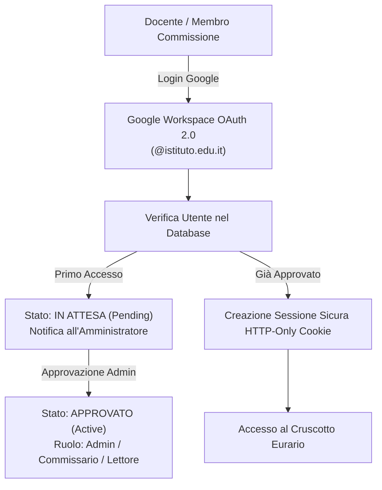
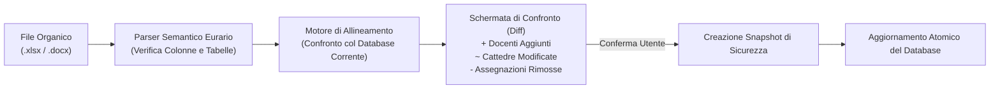

# 🚀 Primo Accesso & Configurazione Iniziale

Questa guida accompagna la commissione orario nei primi passi all'interno dell'applicazione web di Eurario, dall'autenticazione iniziale fino alla configurazione analitica di tutte le anagrafiche della scuola.

---

## 1. Autenticazione & Gestione Utenti (RBAC)

Eurario implementa un sistema di controllo degli accessi basato sui ruoli (*Role-Based Access Control*), conforme al GDPR e progettato per la sicurezza dei dati scolastici:

* **Accesso con Google Workspace**: Gli utenti possono autenticarsi direttamente con il proprio account istituzionale (es. `nome.cognome@nomeistituto.edu.it`). Non è richiesta la memorizzazione di password locali.
* **Flusso di Registrazione Protetta**: Al primo accesso con Google, l'utenza viene collocata in stato *"In Attesa"* (`pending`). L'amministratore dell'applicazione riceve una segnalazione nel pannello di amministrazione e può approvare l'accesso assegnando i permessi opportuni (`admin`, `editor`, `viewer`).
* **Modalità Dimostrativa & Stand-Alone**: Se la variabile `GOOGLE_CLIENT_ID` non è impostata nel container Docker, Eurario funziona automaticamente in modalità locale autonoma, permettendo l'accesso diretto alla scuola predefinita senza necessità di token esterni.

---

## 2. Architettura Multi-Istituto (Multi-Tenant)

Eurario supporta nativamente la gestione di **più istituti scolastici indipendenti** all'interno della stessa istanza:

* **Isolamento Rigoroso dei Dati**: I dati di ogni scuola risiedono in una directory dedicata sotto `data/<school_id>/`, con il proprio file `project.json`, le istantanee storiche (`snapshots/`) e l'ultimo orario calcolato (`solved_timetable.xml`).
* **Commutazione Rapida**: Tramite il menu a tendina **Istituti** nella barra superiore, gli amministratori autorizzati possono passare istantaneamente da una scuola all'altra o creare un nuovo istituto scolastico vuoto.
* **Protezione Concorrenza Ottimistica (OCC)**: Ogni salvataggio incrementa un contatore `data_version`. Se due membri della commissione modificano contemporaneamente i dati della stessa scuola, Eurario intercetta il conflitto, impedisce la sovrascrittura accidentale e propone il confronto visivo tra le modifiche concorrenti.

---

## 3. Anagrafica Plessi & Aule

Prima di inserire le classi e i docenti, è necessario definire gli spazi fisici dell'istituto:

### A. Plessi Scolastici (Buildings)
Negli istituti distribuiti su più sedi (es. *Sede Centrale* e *Succursale*):
* **Nome del Plesso**: Denominazione ufficiale dell'edificio.
* **Codice Breve**: Sigla identificativa (es. `C` per Centrale, `S` per Succursale), usata nei badge dell'orario.
* **Tempo di Trasferimento (Travel Time)**: Tempo stimato in minuti per lo spostamento stradale tra un plesso e l'altro. FET utilizza questo parametro per impedire che un docente abbia lezioni consecutive in sedi diverse senza il tempo di viaggio necessario.

### B. Aule & Laboratori (Rooms)
* **Nome Aula**: Es. `Aula 101`, `Lab Informatica 1`, `Palestra Grande`.
* **Plesso di Appartenenza**: Selezione dell'edificio in cui si trova fisicamente l'aula.
* **Capienza Studenti (Capacity)**: Numero massimo di postazioni disponibili. Eurario verifica la capienza durante l'assegnazione delle classi.
* **Tipologia Aula**: Standard, Palestra, Laboratorio Informatica, Laboratorio Scienze, Aula Disegno.
* **Flag "Laboratorio o Palestra" (`is_lab_or_gym`)**: Segnala a FET e al generatore di stampe che l'aula è una risorsa condivisa a disponibilità limitata.

---

## 4. Anagrafica Classi & Articolazioni Didattiche

Le classi rappresentano i gruppi di studenti per i quali FET genererà un orario continuo e compatto.

### A. Parametri della Classe Ordinaria
* **Nome Classe**: Sigla ministeriale della classe (es. `1A`, `2B`, `3CSA`, `5BL`).
* **Numero Studenti**: Popolazione scolastica della classe (usata per il controllo capienza aule).
* **Aula Base (Home Room)**: L'aula ordinaria assegnata stabilmente alla classe (`ConstraintStudentsSetHomeRoom`).
* **Plesso Predefinito**: Edificio di riferimento della classe.
* **Preset Settimanale (Liceo / Tecnico)**: Eurario permette di applicare con un clic la struttura oraria tipica (settimana a 5 o 6 giorni, con blocco automatico delle ore pomeridiane o attivazione dei rientri per le classi del triennio).

### B. Gruppi & Classi Articolate
Negli istituti in cui le classi si dividono per specifiche discipline (es. seconda lingua comunitaria o indirizzi tecnici):
* **Sottogruppi / Articolazioni**: Eurario crea automaticamente le sotto-entità collegate (es. `3A_FRA` e `3A_SPA` per Francese/Spagnolo, oppure `4A_MECC` e `4A_ENERG` per articolazioni tecniche).
* **Compresenza e Spazi**: Durante le ore articolate, i due gruppi svolgono lezione nella medesima ora ma in aule o laboratori distinti, senza generare conflitti orari per la classe madre.

---

## 5. Anagrafica Materie Scolastiche & Sigle per Stampe

La gestione delle materie in Eurario include sia i metadati didattici sia i parametri tipografici:

  
  
Figura 2.1: Modale di configurazione materia scolastica, codice CDC, sigla breve per stampe e fasce orarie.

### Dettaglio dei Parametri della Disciplina:
* **Nome Esteso**: Denominazione curricolare completa (es. *Scienze Naturali, Chimica e Geografia*).
* **Nome Breve per le Stampe (`short_name`)**: Campo opzionale fondamentale per i tabelloni cartacei. Se valorizzato (es. `MAT`, `FIS`, `SCI`, `DIR`, `ING`), viene utilizzato nelle celle del tabellone Word (.docx) e PDF evitando testi a capo e preservando l'allineamento tipografico. Se omesso, Eurario genera automaticamente una sigla abbreviata intelligente.
* **Classe di Concorso (CDC)**: Codice ministeriale di riferimento (es. `A012`, `A027`, `A048`, `B015`).
* **Fascia Oraria Preferita (`pref_hours`)**:
  * `PRIME`: Assegna priorità FET per la collocazione nelle prime 3 ore del mattino (ideale per compiti in classe, materie logico-matematiche o prove complesse).
  * `ULTIME`: Favorisce la collocazione nelle ore finali della mattinata o nel pomeriggio (ideale per Scienze Motorie o laboratori artistici/pratici).
  * `INDIFFERENTE`: Nessuna preferenza oraria specifica.
* **Esclusione Rientri Pomeridiani (`no_rientri`)**: Opzione di salvaguardia didattica che vieta la collocazione della disciplina in 7ª o 8ª ora pomeridiana.

---

## 6. Anagrafica Docenti & Vincoli Contrattuali

Ogni docente registrato in Eurario è associato a rigorosi vincoli contrattuali:

* **Nome Completo & Sigla Docente (`short_name`)**: Eurario calcola automaticamente la sigla ufficiale per i tabelloni compatti (es. `ROSSI M.`, `BIANCHI L.`).
* **Monte Ore Cattedra (`target_hours`)**:
  * Orario intero contrattuale: **18 ore** (nella secondaria di I e II grado).
  * Contratti Part-Time: 8, 9, 10, 12, 14 o 15 ore settimanali.
* **Tipologia Contratto (`contract_type`)**: `intera`, `part-time`, `spezzone`.
* **Giorni di Presenza Minimi e Massimi (`min_days` e `max_days`)**:
  * Cattedra intera: tipicamente 5 giorni a settimana (con 1 giorno libero su 6) o 5 su 5.
  * Part-time: calcolato automaticamente (es. 9 ore distribuite su 2 o 3 giorni; 12 ore su 3 o 4 giorni).
* **Cattedra Orario Esterna (COE)**:
  * Flag `is_coe` attivo.
  * Ore di servizio nella scuola esterna (`coe_hours`) e giorni di completamento esterno fissati (`coe_days`).
  * Eurario deduce automaticamente le ore esterne dal totale contrattuale e impone a FET il blocco assoluto nei giorni dedicati alla scuola esterna.
* **Plessi Abilitati (`allowed_buildings`)**: Negli istituti multi-sede, definisce a quali plessi il docente può essere assegnato.
* **Griglia Interattiva delle Indisponibilità**:
  * Matrice settimanale (giorni x ore) dove è possibile contrassegnare con un clic il **giorno libero contrattuale** o le fasce orarie in cui il docente non può fare lezione per impegni istituzionali (es. permessi 104, dottorato, impegni di presidenza).
  * FET traduce questi slot nel vincolo hard `<ConstraintTeacherNotAvailableTimes>` a peso 100%.

  
  
Figura 2.2: Scheda docente e matrice settimanale per l'impostazione rapida del giorno libero e delle indisponibilità orarie.

---

## 7. Importazione Automatica dell'Organico da Excel o Word

Invece di digitare manualmente centinaia di docenti e assegnazioni cattedra, Eurario integra un potente motore di ingestione dati:

1. **Import da Excel (`.xlsx`) o CSV**: Caricamento di fogli elettronici strutturati con colonne standard (*Docente, Classe di Concorso, Classe/Gruppo, Materia, Ore Settimanali*).
2. **Import da Modello Word Ufficiale (`.docx`)**: Eurario permette di scaricare un template Word precompilato, modificarlo in segreteria e ricaricarlo direttamente nel sistema.
3. **Analisi Preventiva di Congruenza (`analyze_cattedre_alignment`)**:
   * Prima di toccare i dati, Eurario evidenzia in verde i nuovi docenti, in giallo le variazioni di ore cattedra e in rosso le assegnazioni rimosse.
   * Il sistema verifica che il totale delle ore per classe corrisponda al piano di studi ministeriale (es. 27h al biennio del liceo scientifico, 30h al triennio).
4. **Istantanea di Salvataggio Automatica**: Prima di applicare le modifiche dell'importazione, viene creato uno snapshot nominato (*"Pre-Import Organico"*), consentendo di annullare l'operazione in qualsiasi momento con un clic.
