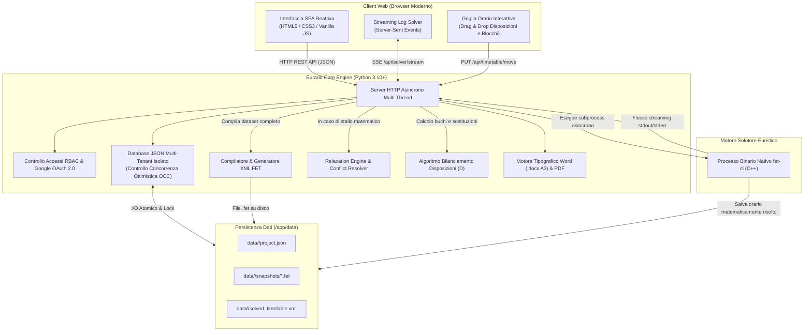
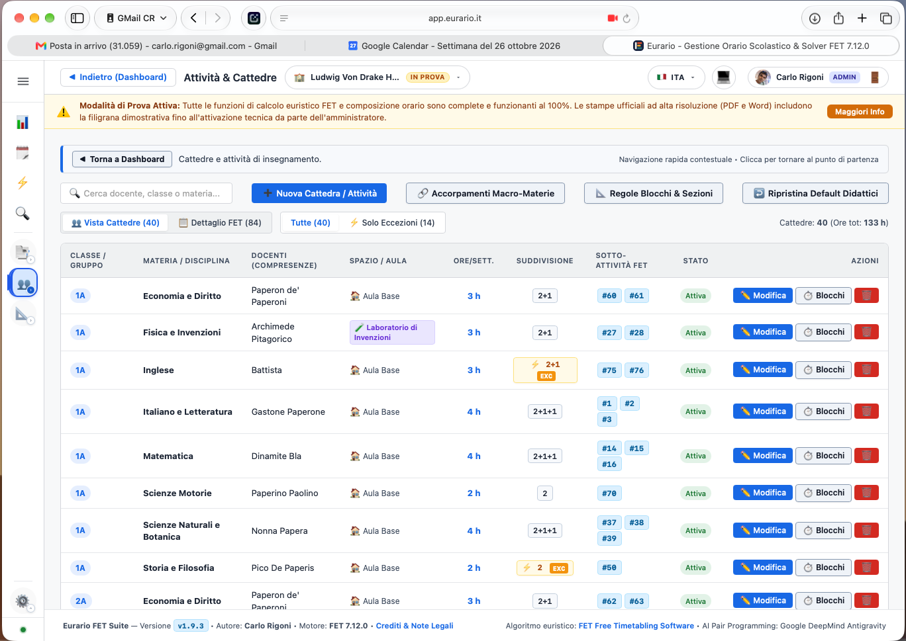

# 🎓 Eurario — Documentazione Ufficiale

Benvenuti nella documentazione tecnica e operativa di **Eurario**, la suite moderna, libera e open source progettata specificamente per la modellazione, risoluzione matematica, ottimizzazione e pubblicazione dell'orario scolastico negli istituti secondari di primo e secondo grado italiani.

Eurario coniuga un'interfaccia web reattiva e collaborativa (ispirata ai canoni del Material Design 3 e Google Classroom) con la proverbiale affidabilità del rinomato motore solutore euristico nativo **FET** (*Free Timetabling Software*), sviluppato da Liviu Lalescu e Volker Dirr.

---

## 🧭 Navigazione Rapida della Guida

  <a href="getting-started/" class="eurario-card">
    <h3>🚀 Primo Accesso & Anagrafiche</h3>
    
Autenticazione sicura con Google Workspace, gestione multi-istituto, anagrafiche docenti, classi, articolazioni, materie con sigle per stampe, aule e plessi.

  </a>

  <a href="user-guide/" class="eurario-card">
    <h3>📖 Guida Utente & Casi d'Uso</h3>
    
Guida operativa cronologica passo-passo e 10 casi d'uso concreti: part-time, COE, compresenze, articolazioni, palestre e relaxation engine.

  </a>

  <a href="timetable-flow/" class="eurario-card">
    <h3>⚡ Flusso di Generazione & Ottimizzazione</h3>
    
Assegnazione cattedre, scomposizione automatica in blocchi (2+1+1), solutore asincrono con log SSE, diagnostica Relaxation Engine e algoritmo disposizioni.

  </a>

  <a href="cross-reference/" class="eurario-card">
    <h3>🔬 Parametri & Cross-Reference FET</h3>
    
Tavola di corrispondenza esaustiva tra le impostazioni didattiche di Eurario e i tag XML generati per il motore C++ FET (vincoli di tempo, spazio e didattici).

  </a>

  <a href="docker-deploy/" class="eurario-card">
    <h3>🐳 Installazione & Deploy con Docker</h3>
    
Deploy rapido on-premise su server Linux x86/ARM, Docker Compose, Synology NAS, reverse proxy con Nginx/Traefik e Cloudflare Tunnel HTTPS.

  </a>

---

## 🏛️ L'Architettura del Sistema

Eurario è strutturato secondo un'architettura modulare a micro-componenti, interamente containerizzata e priva di dipendenze esterne pesanti:

---

## 🌟 Punti di Forza & Conformità CCNL Scuola

Eurario è stato ingegnerizzato attorno alle reali complessità organizzative, didattiche e contrattuali della scuola secondaria italiana:

### 1. Rispetto Rigoroso dei Contratti Docenti
* **Cattedre Standard (18 ore)**, **Part-Time Orizzontale/Verticale** (da 2 a 5 giorni di servizio) e **Spezzoni orari**.
* **Cattedre Orario Esterne (COE)**: Configurazione flessibile di ore e giorni di servizio dedicati alla scuola esterna di completamento, sottraendoli automaticamente dal vincolo settimanale interno.
* **Tutela del Giorno Libero Contrattuale**: Blocco assoluto a livello di vincolo rigido FET (*Hard Constraint 100%*).
* **Controllo Ore Buche**: Limitazione delle finestre libere tra le ore di lezione a un massimo giornaliero (es. 1 ora) e settimanale (es. 2 ore).
* **Minimo Ore Giornaliere**: Impostazione di una soglia minima (es. 2 ore) per evitare che un docente si rechi a scuola per una sola ora di servizio.

### 2. Didattica e Articolazioni Complesse
* **Scomposizione Automatica in Blocchi Didattici**: Conversione intelligente del monte ore disciplinare in sequenze ottimali (`2+1+1` per 4 ore, `2+1` per 3 ore, `2+2+1+1` per 6 ore, `2` per Scienze Motorie o laboratori pratici).
* **Macro-Materie & Regole di Accorpamento**: Gestione unificata per insegnamenti compositi (es. *Italiano, Storia e Geografia* o *Matematica e Fisica*) con possibilità di indicare discipline distinte per le stampe ufficiali.
* **Classi Articolate & Sdoppiamenti**: Supporto nativo per gruppi linguistici (*Inglese / Francese / Tedesco / Spagnolo*) o articolazioni di indirizzo nel triennio degli istituti tecnici e professionali.
* **Fasce Orarie Preferenziali**: Incentivazione della collocazione nelle prime ore del mattino (*PRIME*) per materie impegnative o nelle ultime ore (*ULTIME*) per attività laboratoriali o motorie.
* **Divieto Assoluto Rientri Pomeridiani**: Flag esplicito per escludere materie teoriche o specifiche dalle ore pomeridiane (7ª e 8ª ora).

### 3. Logistica Multi-Plesso & Aule Speciali
* **Centrale e Succursali**: Gestione del personale docente in servizio su più edifici scolastici, con parametri per il tempo di viaggio stradale (*travel time*) e vincoli sul numero massimo di cambi sede al giorno.
* **Aule Speciali e Palestre**: Gestione delle aule a capienza limitata, palestre con suddivisione a metà campo e laboratori specialistici condivisi tra più classi.

### 4. Gestione Disposizioni & Supplenze ("D")
* **Algoritmo di Bilanciamento Dinamico**: Collocazione automatica delle ore a disposizione per coprire i buchi orari dei docenti e massimizzare la presenza di personale per supplenze nelle fasce orarie critiche.
* **Griglia Interattiva Drag & Drop**: Spostamento manuale delle ore "D" con verifica immediata di sovrapposizioni e vincoli contrattuali.
* **Personalizzazione Funzioni**: Assegnazione di note specifiche (es. *Biblioteca*, *Supporto Laboratorio*, *Coordinamento*).

### 5. Esportazioni Tipografiche e Condivisione
* **Tabellone Docenti Ufficiale in Microsoft Word (.docx)**: Layout A3 Orizzontale conforme alla Procedura 12 ministeriale con righe di intestazione ripetute, protezione split riga (`cantSplit`), eliminazione automatica colonne vuote e colorazione differenziata delle ore di disposizione.
* **Quadri Orario Classi Tipografici**: Generazione PDF e HTML con palette pastello ad alto contrasto o modalità *Toner-Save* monocromatica per fotocopiatori d'istituto.
* **Protezione Dati Multi-Utente (OCC)**: Meccanismo di *Optimistic Concurrency Control* basato su versioni progressive del database per prevenire sovrascritture accidentali tra i componenti della commissione orario.

---

## 🖥️ Interfaccia Web a Colpo d'Occhio

A differenza dei software tradizionali basati su complesse finestre di dialogo a più livelli, Eurario offre un ambiente web unificato e reattivo dove ogni docente, classe, cattedra e vincolo è costantemente visibile e modificabile in tempo reale:

  
  
Figura 1.1: Schermata principale di gestione cattedre e scomposizione automatica blocchi in Eurario.

---

## 📜 Licenza & Crediti del Progetto

Eurario è software libero rilasciato sotto i termini della licenza **GNU Affero General Public License v3 (AGPLv3)**.

* **Ideazione, Architettura & Sviluppo Full-Stack**: [Carlo Rigoni](https://github.com/carlorigoni)
* **Mentore dell'Orario & Guida Metodologica**: Federico Rettore
* **Motore Euristico FET**: Liviu Lalescu e Volker Dirr ([Sito ufficiale FET](https://lalescu.ro/liviu/fet/))
* **Repository Ufficiale GitHub**: [github.com/carlorigoni/eurario](https://github.com/carlorigoni/eurario)
