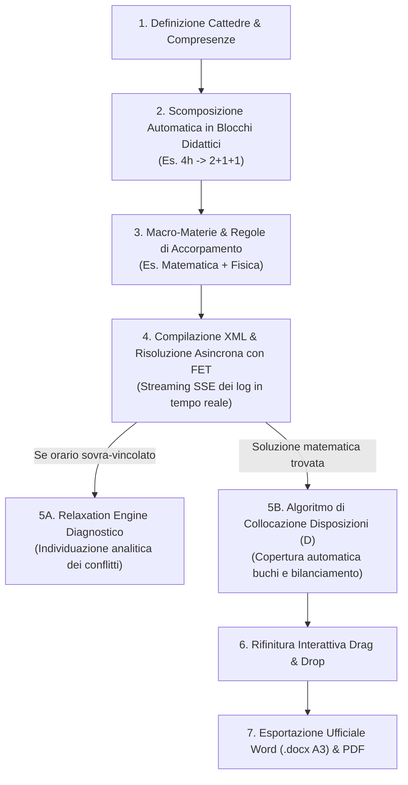
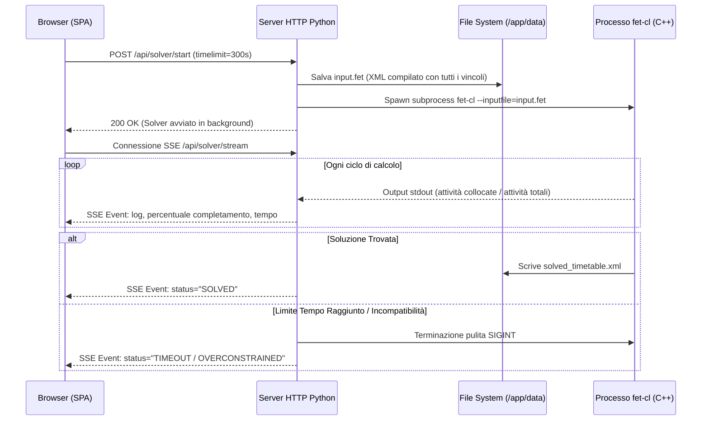
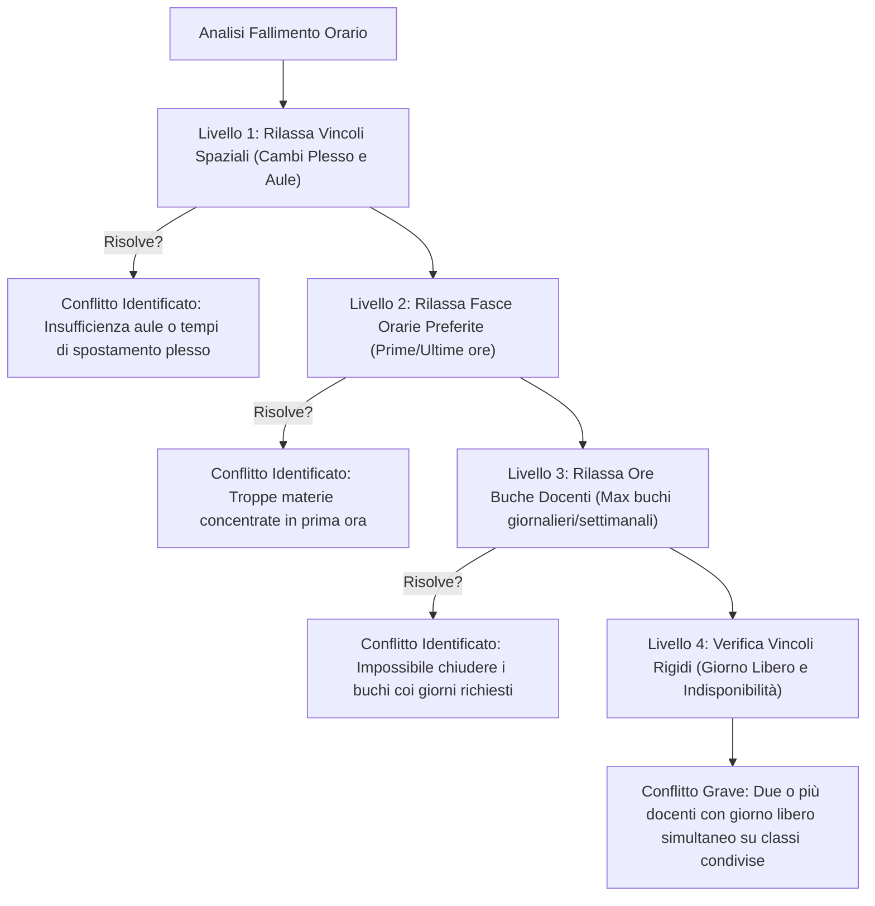

# ⚡ Gestione, Risoluzione & Ottimizzazione dell'Orario

La costruzione di un orario scolastico ottimale richiede il bilanciamento matematico tra vincoli rigidi contrattuali (disponibilità, pause, tempi di spostamento) e criteri pedagogici (distribuzione settimanale equilibrata, consecutività dei laboratori, prime ore per prove scritte).

In Eurario, questo flusso è strutturato in **6 fasi consecutive, completamente controllabili e reversibili**.

---

## 1. Definizione Cattedre & Scomposizione in Blocchi Didattici

In Eurario, una **Cattedra** rappresenta il contratto didattico tra uno o più docenti (compresenze), una classe (o gruppo articolato) e una disciplina per un determinato monte ore settimanale.

### La Logica dei "Blocchi Didattici" (Split Sub-Activities)
Il motore solutore FET non assegna un monte ore astratto, ma singole **sotto-attività atomiche** (*Sub-activities*), ciascuna caratterizzata da una durata specifica (1 ora singola, 2 ore consecutive per compiti o laboratori, 3 ore per prove grafiche).

Eurario implementa la funzione euristica `compute_fallback_blocks(total_hours, subject)` che scompone automaticamente il monte ore settimanale secondo i migliori canoni didattici italiani:

| Ore Settimanali | Suddivisione Predefinita | Esempi Tipici & Varianti Didattiche |
| :---: | :---: | :--- |
| **1 ora** | `1` | Religione Cattolica, Materia Alternativa |
| **2 ore** | `2` *(oppure `1+1`)* | `2` per Scienze Motorie, Disegno; `1+1` per materie orali |
| **3 ore** | `2+1` | Storia dell'Arte, Filosofia, Lingua Inglese |
| **4 ore** | `2+1+1` *(oppure `2+2`)* | `2+1+1` per Matematica/Fisica; `2+2` per Laboratori pratici |
| **5 ore** | `2+1+1+1` *(oppure `2+2+1`)* | Latino nei licei classici, Lingua e Letteratura Italiana |
| **6 ore** | `2+2+1+1` | Lettere (Italiano e Storia) nel biennio della secondaria |
| **7 ore** | `2+2+2+1` | Accorpamento Matematica e Fisica o Italiano e Latino |
| **8 ore** | `2+2+2+2` | Discipline d'indirizzo professionale con doppi laboratori |

### Sovrascrittura Personalizzata & Verifica di Fattibilità (`check_cattedra_feasibility`)
La commissione può sovrascrivere in qualunque momento la suddivisione digitando direttamente la sequenza desiderata (es. `1+1+1` invece di `2+1`). Eurario esegue due controlli automatici:
1. **Controllo Somma Ore**: Verifica che la somma aritmetica dei blocchi coincida esattamente con il monte ore della cattedra.
2. **Verifica di Fattibilità sui Giorni Docente**: Se un docente ha un contratto part-time su 3 giorni ma la cattedra prevede 4 blocchi (`1+1+1+1`), il sistema segnala immediatamente l'incompatibilità logica prima di lanciare il calcolo con FET.

---

## 2. Macro-Materie & Regole di Accorpamento

Nel sistema scolastico italiano, molte cattedre comprendono più materie formalmente distinte affidate al medesimo docente:
* **Italiano, Storia e Geografia** (7 ore complessive nel biennio).
* **Matematica e Fisica** (7 o 8 ore complessive nel triennio scientifico).
* **Filosofia e Storia** (5 o 6 ore complessive nei licei).

Attraverso il modulo **Accorpamenti**:
1. Il sistema individua automaticamente i candidati (`get_accorpamenti_candidates`) che insegnano discipline affini nella stessa classe.
2. Applicando l'accorpamento, le attività separate vengono fuse in un unico gruppo didattico omogeneo con blocchi ottimizzati (es. `2+2+2+1`), evitando la duplicazione di vincoli.
3. Nei tabelloni di stampa finali, Eurario preserva la distinzione curricolare assegnando a ciascuna ora la denominazione della specifica disciplina.

---

## 3. Compilazione XML & Risoluzione Asincrona con FET

Quando la commissione avvia il calcolo, Eurario avvia una pipeline asincrona multi-thread:

### Caratteristiche del Processo di Calcolo:
* **Esecuzione Non Bloccante**: Il server Python esegue il binario nativo C++ `fet-cl` in un thread separato. L'utente può navigare nell'applicazione senza interrompere il calcolo.
* **Streaming SSE in Tempo Reale**: La console di Eurario riceve gli aggiornamenti di avanzamento (numero di attività collocate, tentativi al secondo, tempo trascorso).
* **Arresto Controllato**: Tramite il pulsante *"Interrompi"*, il sistema invia un segnale `SIGINT` a `fet-cl` permettendogli di salvare l'eventuale soluzione parziale migliore prima dell'uscita.

---

## 4. Relaxation Engine Diagnostico (Risoluzione Conflitti)

Se FET non riesce a trovare una soluzione valida entro il tempo limite, significa quasi sempre che i vincoli impostati dalla scuola sono matematicamente incompatibili tra loro (*Over-constrained Timetable*).

Invece di lasciare la commissione nell'incertezza, il **Relaxation Engine** di Eurario esegue un'analisi gerarchica progressiva disattivando temporaneamente i vincoli secondari per isolare il nodo del conflitto:

Il report diagnostico indica chiaramente il nome del docente o della classe interessata, indicando l'azione correttiva minima suggerita (es. *"Consentire 1 ora buca in più al Prof. Bianchi"* oppure *"Spostare il giorno libero della Prof.ssa Neri dal Mercoledì al Venerdì"*).

---

## 5. Algoritmo di Collocazione delle Disposizioni ("D")

Dopo che FET ha collocato tutte le ore di lezione curricolari, i docenti con cattedra inferiore alle 18 ore hanno un monte ore residuo destinato alle supplenze e alla vigilanza (*Disposizioni* o *Potenziamento*).

Eurario include un algoritmo euristico proprietario (`place_disposizioni_in_timetable`) che colloca queste ore secondo criteri di massima efficienza organizzativa:

### Le Fasi dell'Algoritmo:
1. **Calcolo Residuo Contrattuale**: Per ciascun docente, Eurario calcola:
   $$\text{Ore Disposizione} = \text{target\_hours} - \sum \text{ore curricolari assegnate}$$
2. **Priorità 1 — Chiusura dei Buchi Orari**: L'algoritmo cerca anzitutto le finestre vuote tra due ore di lezione dello stesso docente. Assegnando l'ora di disposizione nel "buco", il docente ottimizza la permanenza a scuola senza dover allungare la propria giornata.
3. **Priorità 2 — Accodamento Naturale**: Se il docente non ha ore buche, la disposizione viene posizionata adiacente alle sue lezioni, rispettando il limite massimo di ore giornaliere (es. mai più di 4 o 5 ore complessive).
4. **Priorità 3 — Bilanciamento Globale delle Supplenze**: L'algoritmo monitora costantemente il numero di docenti a disposizione presenti in ogni singola ora della settimana, evitando ore scoperte e distribuendo le presenze in modo uniforme per garantire la massima copertura supplenze.

---

## 6. Griglia Interattiva, Snapshot & Stampe Ufficiali

  
  
Figura 3.1: Tabellone orario settimanale con visualizzazione per classi o docenti, collocazione automatica disposizioni (D) e drag & drop.

### Strumenti Operativi Avanzati:
* **Drag-and-Drop Reattivo**: Ogni ora di disposizione o lezione può essere trascinata manualmente sulla griglia orario. Il sistema valida istantaneamente che il nuovo slot sia libero da sovrapposizioni.
* **Descrizione Personalizzata (`custom_desc`)**: È possibile assegnare una specifica funzione all'ora a disposizione (es. *Biblioteca*, *Coordinamento*, *Supporto Disabili*).
* **Blocco Slot (`toggle_activity_lock`)**: Permette di bloccare un'attività in una determinata ora e giorno, impedendo che ricalcoli successivi o riallineamenti automatici la spostino.
* **Gestione Snapshot**: Creazione di checkpoint orari nominati (es. *"Orario Definitivo Ottobre"*, *"Bozza 2 Rientri"*). Possibilità di ripristino istantaneo o download del file sorgente `.fet`.
* **Esportazione Word (.docx) Tabellone Docenti A3 Orizzontale**:
  * Strutturato secondo la Procedura 12 ministeriale per affissione in sala professori.
  * Righe di intestazione ripetute automaticamente su ogni foglio (`tblHeader`).
  * Protezione interruzione riga (`cantSplit`) per preservare la leggibilità.
  * Evidenziazione cromatica ambra per le ore "D" di disposizione.
* **Esportazione Classi PDF & HTML**:
  * Visualizzazione a colori con palette pastello per materia.
  * Modalità *Toner-Save* monocromatica per la stampa massiva a basso consumo di inchiostro.
