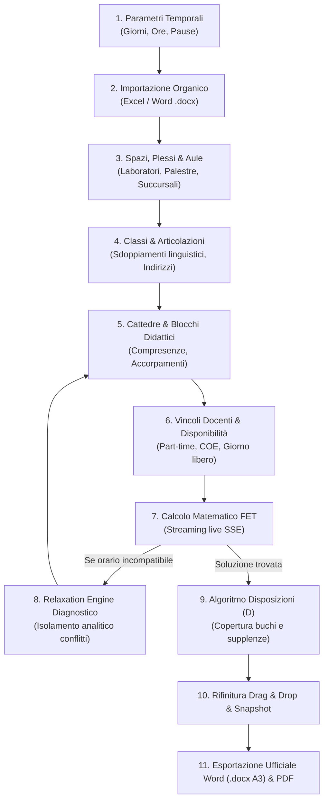

# 📖 Guida Utente Completa & Casi d'Uso Reali

La redazione dell'orario scolastico negli istituti secondari italiani è una delle sfide organizzative più complesse per la dirigenza scolastica e la commissione orario. È necessario coniugare vincoli contrattuali stringenti (CCNL Scuola), esigenze didattiche degli studenti, limitazioni logistiche (aule, palestre, laboratori) e gestione del personale in servizio su più sedi o su contratti part-time.

Questa guida presenta il **flusso operativo cronologico end-to-end** e approfondisce **10 casi d'uso concreti**, illustrando come modellarli e risolverli con Eurario.

---

## 🗺️ Il Flusso Operativo End-to-End

---

### Fase 1: Configurazione Temporale dell'Istituto
Prima di inserire persone o classi, si stabilisce la griglia settimanale della scuola:
1. Accedere al menu **Impostazioni Orario**.
2. **Giorni della Settimana**: Selezionare tra settimana corta (5 giorni, Lunedì–Venerdì) o settimana tradizionale (6 giorni, Lunedì–Sabato).
3. **Ore di Lezione Giornaliere**: Impostare il numero standard di ore al giorno (es. 6 ore ordinarie: $08:00 - 14:00$).
4. **Rientri Pomeridiani (Opzionali)**: Se l'istituto attua la settimana corta con rientri per il triennio tecnico o liceale, abilitare la 7ª e 8ª ora pomeridiana.
5. **Intervallo di Istituto**: Indicare l'ora al termine della quale si tiene la ricreazione (es. dopo la 3ª ora) per attivare il vincolo `<ConstraintBreakTimes>`.

---

### Fase 2: Ingestione e Allineamento dell'Organico
Invece di inserire manualmente docenti e cattedre:
1. Nel menu **Snapshot & Organico**, cliccare su **Carica File Organico**.
2. Selezionare il foglio Excel (`.xlsx`), CSV o il modello ufficiale Word (`.docx`) compilato dalla segreteria.
3. Il motore analitico (`analyze_cattedre_alignment`) confronta i dati con il database della scuola e mostra il modale di verifica (Diff visivo):
   * 🟢 **Verde**: Nuovi docenti e assegnazioni aggiunte.
   * 🟡 **Giallo**: Cattedre con monte ore modificato.
   * 🔴 **Rosso**: Assegnazioni rimosse.
4. Cliccare su **Applica Modifiche con Snapshot**: Eurario crea automaticamente un checkpoint di ripristino sicuro prima di aggiornare il database.

---

### Fase 3: Modellazione degli Spazi e delle Sedi (Plessi)
1. **Plessi (Buildings)**: Se la scuola opera su più edifici (es. *Centrale* in centro storico e *Succursale* in periferia), creare le due entità impostando il **tempo di trasferimento stradale** (es. 15 minuti).
2. **Aule Ordinarie**: Registrare le aule ordinarie associandole al rispettivo plesso.
3. **Spazi a Risorsa Limitata**: Registrare palestre, aule informatiche e laboratori di scienze attivando la spunta **Laboratorio o Palestra** (`is_lab_or_gym`) per informare FET che lo spazio è conteso da più classi.

---

### Fase 4: Classi, Indirizzi e Gruppi Articolati
1. Creare le classi curricolari (es. `1A`, `2B`, `3CSA`) indicando:
   * Numero studenti (usato da Eurario per verificare la capienza aule).
   * **Aula Base (Home Room)**: L'aula assegnata stabilmente alla classe.
2. Per gli istituti con **classi articolate** (es. sdoppiamento linguistico Francese/Spagnolo nel liceo linguistico o Meccanica/Energia nel tecnico), Eurario crea i sottogruppi collegati (`3A_FRA`, `3A_SPA`).

---

### Fase 5: Cattedre, Blocchi Didattici e Accorpamenti
1. Assegnare a ciascuna cattedra il docente (o i docenti per compresenze), la classe o gruppo, la materia e le ore settimanali.
2. Eurario applica istantaneamente la scomposizione didattica in blocchi (`compute_fallback_blocks`):
   * 4 ore di Matematica $\rightarrow$ `2+1+1` (1 blocco da due ore e 2 ore singole).
   * 6 ore di Lettere $\rightarrow$ `2+2+1+1`.
   * 2 ore di Scienze Motorie $\rightarrow$ `2` (blocco unico consecutivo in palestra).
3. **Accorpamenti**: Nel modulo *Accorpamenti*, raggruppare le materie affini insegnate dallo stesso docente nella stessa classe (es. *Matematica e Fisica* 7h $\rightarrow$ `2+2+2+1`).

---

### Fase 6: Vincoli Docenti e Normativa Contrattuale
1. Per ogni docente, verificare il monte ore cattedra (`target_hours`: 18h intera, o part-time).
2. Impostare i giorni di presenza minimi e massimi (`min_days` e `max_days`).
3. Nella **griglia settimanale disponibilità**, contrassegnare in rosso:
   * Il **giorno libero contrattuale**.
   * Le ore di indisponibilità per incarichi speciali, allattamento, permessi 104 o impegni di presidenza.
4. Per docenti con cattedra orario esterna, attivare la spunta **COE** e indicare ore e giorni di completamento nella scuola esterna.

---

### Fase 7: Elaborazione con il Solutore Matematico FET
1. Aprire la sezione **Calcolo Orario & Solver**.
2. Impostare il timeout desiderato (es. 300 secondi o illimitato).
3. Cliccare su **Avvia Solutore FET**:
   * Il processo nativo C++ `fet-cl` viene lanciato in background.
   * La barra di avanzamento e i log streaming via SSE mostrano il numero di attività collocate in tempo reale, i tentativi al secondo e il tempo trascorso.
   * In qualsiasi momento è possibile interrompere il calcolo salvando la migliore soluzione parziale trovata.

---

### Fase 8: Risoluzione Diagnostica con il Relaxation Engine
Se l'orario risulta matematicamente sovra-vincolato (*Over-constrained Timetable*):
1. FET si ferma segnalando l'impossibilità di piazzare tutte le attività.
2. Il **Relaxation Engine** di Eurario esegue l'analisi dei conflitti su 4 livelli gerarchici.
3. Il pannello evidenzia il nodo problematico (es. *"La Prof.ssa Neri e il Prof. Gialli hanno entrambi il giorno libero al Mercoledì nella classe 4B, esaurendo le ore disponibili"*).
4. La commissione applica la modifica minima suggerita e rilancia il calcolo.

---

### Fase 9: Collocazione Intelligente delle Disposizioni ("D")
Una volta calcolate tutte le lezioni:
1. I docenti con monte ore curricolare inferiore a 18h hanno ore a disposizione per supplenze.
2. Cliccare su **Colloca Disposizioni Automatiche**:
   * L'algoritmo proprietario individua i buchi orari dei docenti e li riempie prioritariamente con le ore "D", eliminando i tempi morti.
   * Bilancia la presenza complessiva di supplenti su ogni ora della settimana.

---

### Fase 10: Revisione Fine Interattiva e Salvataggio Snapshot
1. Nel tabellone orario, la commissione può trascinare manualmente qualsiasi ora con **Drag & Drop**:
   * Se lo spostamento causa un conflitto (es. sovrapposizione docente o aula occupata), Eurario segnala immediatamente l'errore.
2. È possibile bloccare le attività definitive cliccando sull'icona del lucchetto (`locked`).
3. Salvare uno **Snapshot Nominato** (es. *"Bozza 1 Approvata"*).

---

### Fase 11: Esportazione Ufficiale Word (.docx) e PDF
1. Cliccare su **Stampe Ufficiali**.
2. Selezionare **Tabellone Docenti Word (.docx)**:
   * File in formato **A3 Orizzontale** conforme alla Procedura 12 ministeriale.
   * Righe di intestazione ripetute automaticamente su ogni foglio.
   * Evidenziazione cromatica ambra per le ore a disposizione ("D").
3. Selezionare **Orari Classi PDF**:
   * Layout settimanale con colori pastello per materia o versione *Toner-Save* per la bacheca studenti.

---

## 💼 10 Casi d'Uso Reali Approfonditi

### Caso d'Uso 1: Docente con Cattedra Orario Esterna (COE)
* **Contesto**: Il Prof. Marco Bianchi (A027, Matematica e Fisica) ha una cattedra di 18 ore complessive: **12 ore** nella scuola principale e **6 ore esterne** in un istituto vicino, dove presta servizio il **Martedì e Giovedì**.
* **Procedura in Eurario**:
  1. Nella scheda Docente, impostare `target_hours: 18`.
  2. Attivare la spunta **Cattedra Orario Esterna (COE)**.
  3. Impostare `Ore Esterne: 6`. Eurario calcola automaticamente che la scuola deve assegnare esattamente $18 - 6 = 12$ ore interne.
  4. Nella matrice delle disponibilità settimanali, cliccare su tutte le ore del **Martedì** e del **Giovedì** per contrassegnarle in rosso (indisponibili).
  5. Impostare `max_days: 3` (Lunedì, Mercoledì, Venerdì).
* **Risultato FET**: FET traduce l'impostazione nel vincolo `<ConstraintTeacherNotAvailableTimes>` al 100% per Martedì e Giovedì e colloca le 12 ore interne rigorosamente nei restanti 3 giorni, senza possibilità di errore.

---

### Caso d'Uso 2: Docente Part-Time Verticale (10 Ore su 3 Giorni)
* **Contesto**: La Prof.ssa Laura Conti (A012, Lettere) usufruisce di un part-time contrattuale al 55% per 10 ore settimanali, con l'accordo di prestare servizio su **massimo 3 giorni alla settimana**. Ha due classi con cattedre da 6 ore e 4 ore.
* **Procedura in Eurario**:
  1. Nella scheda Docente, impostare `target_hours: 10`, `contract_type: part-time`.
  2. Impostare `max_days: 3` e `min_days: 3`.
  3. Suddivisione dei blocchi:
     * Cattedra 6 ore: blocco `2+2+2` (anziché `2+2+1+1` che richiederebbe 4 giorni!).
     * Cattedra 4 ore: blocco `2+2` (anziché `2+1+1` che richiederebbe 3 giorni!).
  4. Eurario esegue il controllo preventivo `check_cattedra_feasibility`: verifica che i 3 blocchi della cattedra 1 e i 2 blocchi della cattedra 2 possano convivere nei 3 giorni concordati.
* **Risultato FET**: FET impone `<ConstraintTeacherMaxDaysPerWeek>3</ConstraintTeacherMaxDaysPerWeek>` e concentra il carico didattico (es. 4h + 3h + 3h = 10h) esattamente nei 3 giorni lavorativi concordati.

---

### Caso d'Uso 3: Cattedra Accorpata di Indirizzo (Matematica e Fisica 7 Ore)
* **Contesto**: Nel triennio del Liceo Scientifico (classe 3B), la cattedra di A027 prevede **4 ore di Matematica** e **3 ore di Fisica**, affidate entrambe al medesimo docente. Gestire le materie separatamente genererebbe vincoli concorrenti e blocchi sub-ottimali.
* **Procedura in Eurario**:
  1. Nel menu **Regole di Accorpamento**, cliccare su **Cerca Candidati**.
  2. Il sistema riconosce che il docente insegna Matematica e Fisica nella classe 3B per complessive 7 ore.
  3. Cliccare su **Applica Accorpamento**:
     * Eurario crea una macro-cattedra da 7 ore con scomposizione didattica automatica `2+2+2+1`.
     * Distribuisce i blocchi su 4 o 5 giorni della settimana.
  4. Nei tabelloni di stampa ufficiali, grazie alle sigle brevi (`MAT`, `FIS`), ogni singola ora viene etichettata correttamente con la rispettiva disciplina.

---

### Caso d'Uso 4: Classe Articolata per Lingue Straniere (Francese e Spagnolo)
* **Contesto**: Nella classe 2A (Liceo Linguistico), 14 studenti studiano Francese (Prof.ssa Dubois) e 12 studenti Spagnolo (Prof. Martinez). Le lezioni devono tenersi contemporaneamente nelle stesse 3 ore settimanali, ma in aule diverse.
* **Procedura in Eurario**:
  1. Nella scheda **Classi & Gruppi**, selezionare la classe `2A` e cliccare su **Aggiungi Articolazione**:
     * Creare il sottogruppo `2A_FRA` (14 studenti) con aula preferita `Aula 105`.
     * Creare il sottogruppo `2A_SPA` (12 studenti) con aula preferita `Lab Linguistico`.
  2. Assegnare la cattedra di Francese 3h (`2+1`) al sottogruppo `2A_FRA`.
  3. Assegnare la cattedra di Spagnolo 3h (`2+1`) al sottogruppo `2A_SPA`.
* **Risultato FET**: FET riconosce che i sottogruppi appartengono alla stessa classe radice e sincronizza le lezioni nelle medesime ore (`ConstraintTwoActivitiesGrouped` / partizione studenti), garantendo che la classe 2A non abbia sovrapposizioni orarie e che ciascun gruppo occupi la propria aula dedicata.

---

### Caso d'Uso 5: Compresenza Didattica in Laboratorio (Teorico + ITP)
* **Contesto**: Nella classe 4A Informatica, l'insegnamento di *Sistemi e Reti* (4 ore settimanali) prevede per 2 ore settimanali la compresenza del docente di teoria (Prof. Verdi, CDC A041) e dell'Insegnante Tecnico Pratico (Prof. Neri, CDC B016) all'interno del *Laboratorio Reti*.
* **Procedura in Eurario**:
  1. Creare una prima attività curricolare da 2 ore singole (`1+1`) affidata al solo Prof. Verdi in aula ordinaria.
  2. Creare una seconda attività da 2 ore consecutive (`2`) affidata **simultaneamente** al Prof. Verdi e al Prof. Neri (selezionando entrambi i docenti nel campo cattedra).
  3. Associare a quest'ultima attività l'aula obbligatoria `Laboratorio Reti`.
* **Risultato FET**: FET compila un'unica attività con `<Teacher>Verdi</Teacher>` e `<Teacher>Neri</Teacher>`, vincolando entrambi i docenti alla presenza congiunta nel medesimo slot e riservando il laboratorio senza possibilità di conflitto.

---

### Caso d'Uso 6: Gestione Multi-Plesso con Tempi di Viaggio (Centrale e Succursale)
* **Contesto**: Un istituto tecnico ha la Sede Centrale e la Sede Succursale a 4 km di distanza (circa 20 minuti di tragitto). 6 docenti insegnano classi in entrambe le sedi.
* **Procedura in Eurario**:
  1. In **Plessi**, registrare `Centrale` e `Succursale`.
  2. Nelle impostazioni di trasferimento, impostare `Travel Time: 20 min` e `Max Cambi Plesso al Giorno: 1`.
  3. Assegnare a ciascuna classe l'edificio di appartenenza.
* **Risultato FET**: FET attiva:
  * `<ConstraintTeachersMaxBuildingChangesPerDay>`: Vieta al docente di cambiare sede più di una volta al giorno.
  * `<ConstraintTeachersMinGapsBetweenBuildingChanges>`: Se un docente deve spostarsi dalla Centrale alla Succursale, FET impone obbligatoriamente un'ora buca intermedia per consentire lo spostamento in sicurezza.

---

### Caso d'Uso 7: Palestre Condivise e Risorse a Capienza Limitata
* **Contesto**: L'istituto dispone di una sola palestra di grandi dimensioni, che può ospitare al massimo 2 classi contemporaneamente (divisa da tenda divisoria), per complessive 40 ore disponibili a settimana. Le classi totali dell'istituto sono 24 (ciascuna con 2 ore settimanali di Scienze Motorie = 48 ore richieste).
* **Procedura in Eurario**:
  1. Registrare due aule distinte: `Palestra Campo A` e `Palestra Campo B` (ciascuna con capienza 30 studenti).
  2. Inserire le cattedre di Scienze Motorie (blocco `2`) per ciascuna classe, indicando come aule consentite sia `Palestra Campo A` sia `Palestra Campo B`.
  3. Eurario calcola preliminarmente il bilancio di saturazione: $24 \text{ classi} \times 2\text{h} = 48\text{ ore}$ a fronte di $2 \text{ campi} \times 30\text{ ore/settimana} = 60\text{ ore}$ disponibili. Poiché $48 \le 60$, il calcolo è teoricamente realizzabile con un margine del 20%.
* **Risultato FET**: FET distribuisce le ore sulle due metà campo (`ConstraintActivityPreferredRooms`) senza mai superare la contemporaneità di due classi in palestra.

---

### Caso d'Uso 8: Risoluzione di un Orario Sovra-Vincolato con il Relaxation Engine
* **Contesto**: Lanciando il calcolo con FET, il solutore raggiunge il 94% delle attività ma si blocca in stallo matematico (*Over-constrained Timetable*).
* **Procedura di Diagnosi in Eurario**:
  1. La schermata di Eurario visualizza il report del **Relaxation Engine**.
  2. Il motore diagnostico indica:
     > *"Conflitto individuato al Livello 3 (Ore buche e giorni di servizio): Il Prof. Ferrari ha 18 ore assegnate su 4 classi, giorno libero il Venerdì, e vincolo di massimo 1 ora buca settimanale. Tuttavia, due delle sue classi non hanno lezioni il Lunedì per rientro pomeridiano."*
  3. **Azione Correttiva**: Nella scheda del Prof. Ferrari, la commissione porta temporaneamente il limite da 1 ora buca a 2 ore buche settimanali, oppure sposta il giorno libero al Giovedì.
  4. Al successivo avvio del solutore, FET trova la soluzione ottima in 35 secondi.

---

### Caso d'Uso 9: Collocazione Ottimizzata delle Ore di Disposizione ("D")
* **Contesto**: Il Prof. Alberto Galli ha una cattedra di 15 ore curricolari. Da contratto a 18 ore, deve effettuare **3 ore a disposizione** della scuola per supplenze e vigilanza.
* **Procedura in Eurario**:
  1. Una volta ottenuto l'orario curricolare risolto, cliccare su **Colloca Disposizioni Automatiche**.
  2. L'algoritmo di Eurario analizza l'orario del Prof. Galli:
     * Trova un buco alla 3ª ora del Martedì (tra la 2ª e la 4ª ora): assegna qui la prima ora di disposizione, chiudendo il buco.
     * Accoda la seconda disposizione alla 5ª ora del Mercoledì dopo le sue lezioni ordinarie.
     * Posiziona la terza disposizione alla 1ª ora del Venerdì per rafforzare la copertura supplenze all'ingresso.
  3. La commissione desidera che la disposizione del Venerdì sia impiegata per il coordinamento dei laboratori: apre la cella e digita nella nota personalizzata (`custom_desc`): *"Coord. Lab Info"*.
  4. Clicca sull'icona del lucchetto: la cella diventa protetta (`locked`) da qualsiasi futuro ricalcolo.

---

### Caso d'Uso 10: Gestione dell'Orario Provvisorio vs Definitivo tramite Snapshot
* **Contesto**: All'apertura dell'anno scolastico (metà settembre), l'istituto adotta un **orario provvisorio a 4 ore giornaliere** senza rientri pomeridiani e con alcuni docenti supplenti non ancora nominati. A metà ottobre, a organico completato, si passa all'**orario definitivo a 6 ore**.
* **Procedura in Eurario**:
  1. **Configurazione Provvisoria**: Impostare 4 ore al giorno, escludere temporaneamente le cattedre scoperte e lanciare FET.
  2. Salvare lo stato cliccando su **Crea Snapshot** con il nome *"2026_09_Orario_Provvisorio_4h"*.
  3. Scaricare il file `.fet` generato come backup storico.
  4. **Passaggio al Definitivo**:
     * Nel menu Impostazioni, estendere la giornata scolastica a 6 ore (e rientri).
     * Completare l'assegnazione dei nuovi docenti nominati dall'ufficio scolastico.
     * Lanciare il solutore FET per l'orario definitivo completo.
     * Salvare lo snapshot *"2026_10_Orario_Definitivo_Ufficiale"*.
  5. In caso di necessità (es. ritardo nell'arrivo dei docenti o ordinanza sindacale), è possibile ripristinare istantaneamente con un solo clic l'orario provvisorio precedente.

---

## 💡 Best Practice per la Commissione Orario

1. **Procedere per Approssimazioni Successive**: Non inserire tutti i vincoli soft contemporaneamente al primo tentativo. Calcolare prima un orario con i soli vincoli rigidi (giorno libero, monte ore, aule obbligatorie) per verificare la compatibilità di fondo dell'organico.
2. **Attenzione ai Giorni Liberi Concorrenti**: Evitare che più docenti della stessa classe abbiano il giorno libero nello stesso giorno della settimana, specialmente nelle classi a tempo pieno con 30 o 32 ore settimanali.
3. **Usare le Sigle di Stampa Brevi (`short_name`)**: Impostare sempre le sigle sintetiche per le materie con denominazione lunga (es. `DIR` per *Diritto ed Economia Politica*) per garantire che i tabelloni stampati in Word (.docx) A3 mantengano celle pulite e perfettamente leggibili.
4. **Salvare Snapshot a Ogni Traguardo**: Creare uno snapshot prima di ogni modifica sostanziale (import organico, accorpamenti, cambio giorno libero docente).
